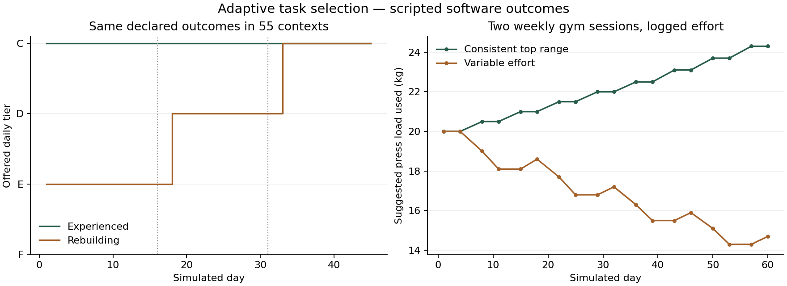

# Current ability across objectives — 1.27

The previous update addressed the pushing example more thoroughly than the wider problem. This pass uses one evidence flow for activity-specific placement and future request suggestions across physical practice, learning, judgment, communication, professions and vocations. RPG stats and guild rank are not substitutes for current real-world proficiency.

## What changes in use

| Area | Placement and useful next work |
| --- | --- |
| Strength | Choose movement setups separately. Comparable work-set logs can progress pressing, rows, legs, hinges and core independently. A strong upper-body test does not certify lower-body readiness. |
| Walking, running, cycling, stairs | Keep separate activity histories and effort/duration checks. A walking result does not certify continuous running. Planned walks honor the selected duration. |
| Coordination and mobility | Check controlled accuracy, sequence and setup. Dexterity is not inferred from cardiovascular speed or a large practice count. |
| Learning and language | Name the actual subject and source level. Use retrieval, correction and unfamiliar application; language includes comprehension and an original response. |
| Writing | Produce and revise an artifact, verify claims and consider audience/alternatives. A fluent speaker is not automatically a proficient writer. |
| Judgment and Scripture | Judgment uses evidence, predictions and later checks; Scripture uses literary context, textual support and alternative interpretations. Neither score measures moral or spiritual worth. |
| Communication | Perform an explanation, recorded-listening summary or difficult-message draft with an explicit rubric. Correct-answer etiquette quizzes are not the only route. |
| Professions and vocations | All 20 career categories have output rubrics; all 25 vocations retain their focus. A teacher checks learning outcomes/misconceptions; a tradesperson checks measurements/tolerances; a chef checks preparation, timing, materials and service quality. |
| Recovery habits | Sleep, meals, prayer and recovery maintain a useful dose. The system does not prescribe endlessly harder recovery. |

**Starting:** open a request → **Check current ability**, perform a suitable F–C sample and record subject, source/setup, independence and criteria met. An experienced person can start at C without first completing beginner tasks. The sample itself gives no rewards. Profession placement is also available at the end of registration; other activity checks remain available on demand.

**Later:** opt into **Use this result to adapt future work** during submission. Two comparable independent results on different local dates, at 85% or above, move the next suggestion up one tier. Mental/career work also needs unfamiliar material. Below 60%, insufficient independence or familiar-only advanced mental work suggests a prerequisite. Correct/attempted counts take precedence over a conflicting self-rating. Records compare activity, subject, source version and tier within 90 days. An intervening new tier/source resets the comparison frontier. These are practice rules, not psychometric mastery cutoffs.

Daily work remains F–C. C mastery calls for harder source material, transfer or a prepared project. Weekly/monthly requirements retain their calendar and assessed-outcome gates. Accepted work remains fixed, including its original progression owner after a class/career change. Samples and result quality do not bypass exams, award credentials or increase base stats.

## Simulation results

**110 daily cases across 55 contexts for 45 days, plus six 60-day home/weights/gym cases: 5,310 account-days.** All 5,058 submitted save roundtrips validate; all 4,950 duplicate daily attempts are refused. Samples award no rewards, and the no-exam/no-special-reward routines leave base stats unchanged.

| Scenario | Day 1 | Day 7 | Day 15 | Day 30 | Day 45 | Total player XP |
| --- | --- | --- | --- | --- | --- | --- |
| Experienced, successful C sample | C | C | C | C | C | 6,750 |
| Rebuilding after an unsuccessful D sample | E | E | E | D | C | 3,275 |

The same capability/quality inputs were deliberately applied in every context, so these 55 pairs share a tier trace. This establishes coverage and consistent selection, not equal human learning rates or reward fairness between occupations. Rebuilding capacity improves by scenario assumption at days 15 and 30; the app does not create that improvement.

Each regimen case submits eighteen sessions. In the consistently successful weights/gym cases, pressing, rows and hinges move from 20 kg to a suggested 24.3 kg; less frequently repeated split squats reach 22 kg. Variable-effort loaded cases finish at 14.7 kg for those three movements and 16.3 kg for split squats after backoffs. In home cases, movements progress separately, while self-resisted rows remain unquantified. Variable effort does not block every bodyweight progression: some pairs of comparable successful sessions still occur, whereas the separately tracked core patterns remain at their initial setup. These are consequences of the declared logs, not predicted strength gains.



[Standalone SVG](selection-and-loads.svg). Recreate the figure with `python3 scripts/plot-adaptive-ability.py` after running the simulation.

## Research and implementation limits

The [source review](../proficiency-1.26/RESEARCH.md) distinguishes freshly read publisher material from established references whose primary full texts were blocked by the environment proxy. This update applies the same principles more broadly: specificity and progressive loading, retrieval/spacing/correction, intuition with feedback, and performed communication. It does not claim a new systematic review or newly validated population norms.

The app-authored four-part rubrics, F–C boundaries, 85%/60% thresholds, 90-day recency, chair/pullup setup cutoffs and bench-to-home trial suggestions are provisional. The 2.5% suggested load increment and 5% zero-reserve reduction are conservative software choices, not universal prescriptions; equipment increments, individual response and recovery matter. Self-resisted rows cannot establish measured overload. Current samples are self-reviewed against a named standard; the app cannot verify a user's marking guide or artifact quality.

Remaining work: externally reviewed discipline standards and trusted placement banks, appropriate substitutions, independent partial-session entries, long-term aerobic-volume planning, calibrated parallel assessments and observed human adherence/improvement. The simulation below verifies selection and retention rules; it cannot establish human efficacy.

## Reproduce

```sh
node scripts/simulate-adaptive-ability.mjs
```

The runner uses actual character, acceptance, result, reward, duplicate and storage-validation APIs. It declares the person's capability and submitted outcomes instead of inferring human learning from the app. Experienced cases begin with a successful C sample. Rebuilding cases initially struggle at D, and their declared capacity improves at days 15 and 30. Workout cases follow two sessions weekly and contrast consistent top-range performance with variable effort. No simulated case manufactures exam passes or credentials. Outputs include source SHA-256 fingerprints.

[Raw results](results.json) · [Daily rows](daily.csv) · [Verification](../verification-1.27.md) · [Changes](../update-1.27.md).

## Screens

[Teacher work sample](screens/teacher-work-sample.png) · [Adapted language work](screens/adapted-language.png) · [Separate gym loads](screens/separate-gym-loads.png) · [Chef milestone](screens/chef-milestone.png) · [Desktop ability settings](screens/ability-settings-desktop.png) · [Scoped scans](screens/scans.json).
