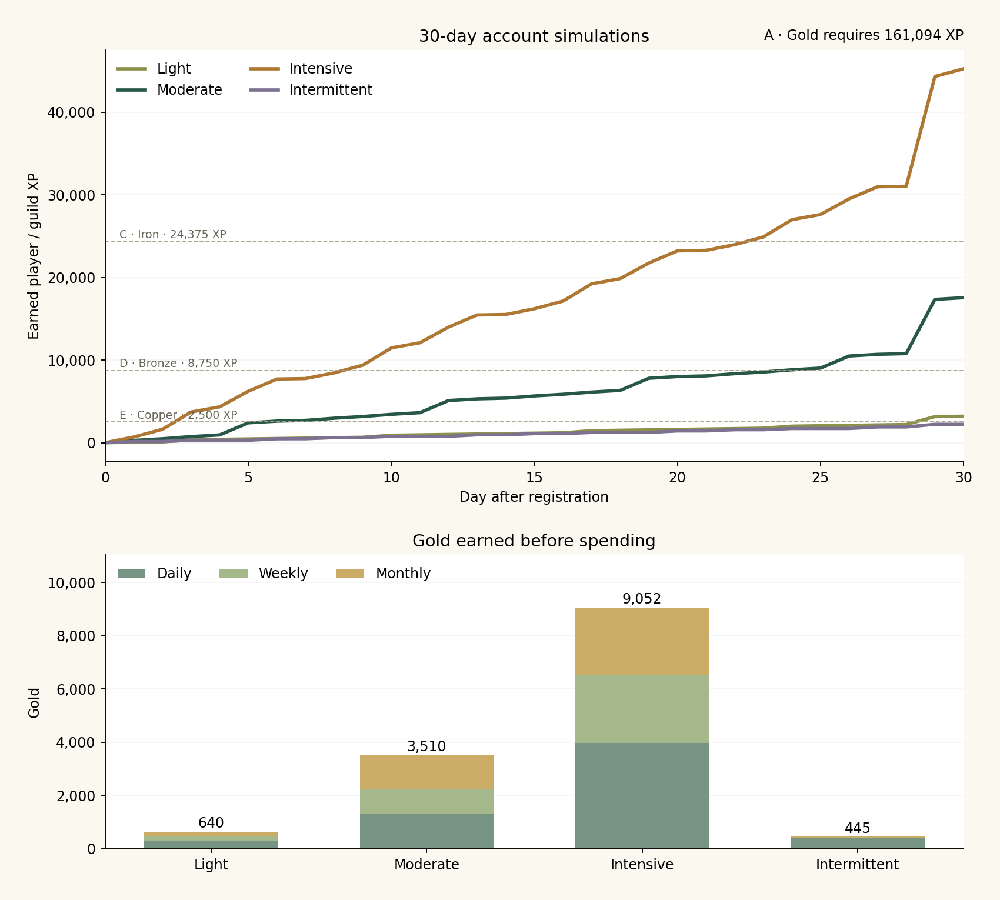
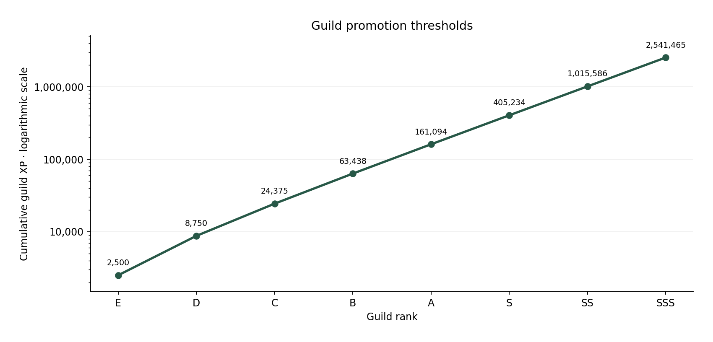

# Request and guild-rank balance report — 1.6.0

The moderate test account reached **E after 7 days and D after 30 days**, earning **17,550 XP** and **3,510 gold**. Repeating that earning rate projects A (Gold) at **276 days, about 9.1 months**, matching the requested 9–12 month target. The intensive account reached C at 30 days. None of these four accounts reached A in its first month.

These are simulated local accounts using the app's real request, reward, progression, and save-validation functions. The fictional test window runs **25 January–23 February 2027**, deliberately crossing a month boundary. No live Google accounts or real-world fitness improvements were created. All accounts begin at F with six stats of 10, the Warrior class, Analyst profession, and Networking vocation. Varying the routines against this shared starting point isolates request and reward behavior.

## 7-day and 30-day results

| Routine      | Day 7 XP | Rank | Day 7 gold | Day 30 XP | Rank | Day 30 gold | Player level |
| ------------ | -------: | :--: | ---------: | --------: | :--: | ----------: | -----------: |
| Light        |      550 |  F   |        110 |     3,200 |  E   |         640 |            7 |
| Moderate     |    2,695 |  E   |        539 |    17,550 |  D   |       3,510 |           19 |
| Intensive    |    7,760 |  E   |      1,552 |    45,260 |  C   |       9,052 |           32 |
| Intermittent |      475 |  F   |         95 |     2,225 |  F   |         445 |            6 |

### Account schedules

- **Light:** five short daily habits: a five-minute walk, mobility, reading, a Bible passage, and a thoughtful-message draft. Five F weekly habit goals and five F monthly habit goals use those dated practices. Approximately 25–35 minutes a day, with occasional reviews.
- **Moderate:** a brisk walk and Scripture comprehension each day; active recall and networking practice six days a week; Warrior practice three days a week. Two C weekly quests and one B Warrior training adventure. Roughly 60–110 minutes on training days; lower workload on the rest day.
- **Intensive:** focused application, chapter study, presentation rehearsal, job/portfolio work, and networking practice six days a week; strength three days a week; additional pushup/running sessions twice a week; and a weekly group hike replacing that day's ordinary walk. Two C preparation quests, one B teaching project, the C hike, and two B monthly projects. This assumes several hours of distinct work on busy days, existing capacity for the exercise, and suitable recovery.
- **Intermittent:** walking, active recall, and Scripture comprehension on three days a week, with one F weekly walking goal and one F monthly walking adventure. Approximately 60–75 minutes on active days.

A daily session can supply dated evidence for a longer goal. The weekly/monthly reward is its completion bonus; each accepted period or adventure run pays once. Work requirements, recovery intervals, practice dates, and checklists are evaluated by the program. Failed or unavailable claims are not added to balances.

| Routine      | Daily XP | Weekly XP | Monthly XP | Completions: daily / weekly / monthly |
| ------------ | -------: | --------: | ---------: | ------------------------------------- |
| Light        |    1,500 |       800 |        900 | 150 / 20 / 5                          |
| Moderate     |    6,450 |     4,800 |      6,300 | 125 / 8 / 1                           |
| Intensive    |   19,860 |    12,800 |     12,600 | 187 / 16 / 2                          |
| Intermittent |    1,885 |       160 |        180 | 39 / 4 / 1                            |

Class and profession milestones remain pending in these fixtures, so trained paths stop at level 4 until their improvement exam is passed. Player levels and guild XP continue independently. No assumed improvement was inserted into an assessment to force those gates open.

## Reward changes

Daily tasks stop at **C**, weekly quests at **A**, and monthly adventures at **SSS**. Difficulty and commitment length both set rewards. Daily rewards use the base rank price; weekly quests pay **4×**, and monthly adventures pay **18×**. Gold follows the same multipliers.

| Request rank | Daily XP / gold | Weekly XP / gold | Monthly XP / gold |
| ------------ | --------------: | ---------------: | ----------------: |
| F            |          10 / 2 |           40 / 8 |          180 / 36 |
| E            |          25 / 5 |         100 / 20 |          450 / 90 |
| D            |         60 / 12 |         240 / 48 |       1,080 / 216 |
| C            |        150 / 30 |        600 / 120 |       2,700 / 540 |
| B            |               — |      1,400 / 280 |     6,300 / 1,260 |
| A            |               — |      3,200 / 640 |    14,400 / 2,880 |
| S            |               — |                — |    32,400 / 6,480 |
| SS           |               — |                — |   75,600 / 15,120 |
| SSS          |               — |                — |  180,000 / 36,000 |

Examples:

- A C daily pushup session pays **150 XP / 30 gold**.
- A C multi-session weekly quest pays **600 XP / 120 gold**.
- A B training adventure pays **6,300 XP / 1,260 gold** after at least 28 days and 12 relevant practice dates.
- A low-difficulty F walking adventure pays **180 XP / 36 gold** for eight separate practice dates across at least 28 days.
- The S pullup target has moved into a preparation adventure: **32,400 XP / 6,480 gold**, at least 56 days and 24 practice dates, plus its existing capacity, equipment, recovery, and outcome requirements. It cannot pay as a day-one daily task.

Demanding B/A single-session targets now belong to prepared weekly quests. Multiweek assessed outcomes belong to adventures. Basic habits have F/E weekly and F/E/D monthly options. Variants of the same weekly habit cannot pay repeatedly in one week, and concurrent monthly variants from the same training family cannot be accepted.

## Monthly persistence and completion gates

Monthly adventures now have individual saved runs. Their start date, relevant practice, checklist, and original class/profession/vocation credit survive a month boundary. Completion pays once for that run. **Take again** explicitly starts new preparation; checklists and accumulated dates do not carry into the next run. Releasing an unfinished adventure also restarts preparation if it is accepted later. SS/SSS one-time commitments stay one-time.

| Monthly rank | Minimum elapsed days | Minimum dated practice days |
| ------------ | -------------------: | --------------------------: |
| F            |                   28 |                           8 |
| E            |                   28 |                          10 |
| D            |                   28 |                          12 |
| C            |                   28 |                          12 |
| B            |                   28 |                          12 |
| A            |                   42 |                          18 |
| S            |                   56 |                          24 |
| SS           |                   84 |                          36 |
| SSS          |                  168 |                          72 |

The start date is elapsed day zero: a 28-day commitment first qualifies on the 29th calendar date. Actual completion still requires the named outcome and checklist. Class adventures count that class's practice; career adventures count the relevant career discipline; specific habit adventures count their named training family. Several completions on one day supply one practice date. SS/SSS also require the listed independent assessment; time by itself never qualifies.

In the early-claim stress check, **44 monthly options** were inspected. **21 compatible adventures** could be accepted; all **21** accepted day-one claims were blocked even after checking every box and supplying forged reward fields. Total earned: **0 XP / 0 gold**, remaining F.

## Guild promotion curve

Each promotion price grows approximately **2.5×**, beginning at 2,500 XP. The exact cumulative threshold for rank index `i` is `round(2500 × (2.5^i − 1) / 1.5)`.

| Rank | Metal      | Cumulative guild XP | XP since previous rank |
| ---- | ---------- | ------------------: | ---------------------: |
| F    | Tin        |                   0 |                      0 |
| E    | Copper     |               2,500 |                  2,500 |
| D    | Bronze     |               8,750 |                  6,250 |
| C    | Iron       |              24,375 |                 15,625 |
| B    | Silver     |              63,438 |                 39,063 |
| A    | Gold       |             161,094 |                 97,656 |
| S    | Platinum   |             405,234 |                244,140 |
| SS   | Mythril    |           1,015,586 |                610,352 |
| SSS  | Orichalcum |           2,541,465 |              1,525,879 |

Player level, class level, and guild rank remain separate. Existing characters retain their earned guild rank and fraction of progress toward the next promotion through a one-time guild credit. That credit adds no player/class/profession XP, gold, or stat points. Existing accepted monthly checklists and start dates are retained during migration.

## Interpretation and limits

The moderate routine's roughly nine-month Gold projection uses the observed 30-day earning rate. It is an estimate; breaks, future request choices, class changes, longer project durations, or multiple difficult projects will change it. The intensive schedule can progress faster because it assumes substantially more distinct work. Rare SSS outcomes can award large rewards after sustained preparation; the curve does not impose a universal calendar lock on rank.

Gold totals are earnings before spending. Existing shop prices are unchanged; the combat economy needs its own playtesting. These simulations evaluate request rewards, persistence, and rank pace. They do not establish actual adherence, exercise outcomes, or the truth of self-reported achievement evidence.

## Reproduce and inspect

Run `npm run simulate:balance`, then `MPLCONFIGDIR=/tmp/guild-matplotlib python3 scripts/write-balance-report.py` to regenerate the report and charts. The chart step uses Matplotlib.

- [Full results and action logs](balance/simulation-results.json)
- [Daily CSV](balance/daily-progress.csv)
- Synthetic account snapshots: [Light](balance/account-light.json), [Moderate](balance/account-moderate.json), [Intensive](balance/account-intensive.json), [Intermittent](balance/account-intermittent.json)
- [Build and workflow verification](verification-1.6.md)
