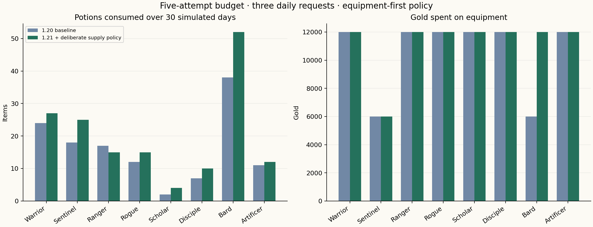
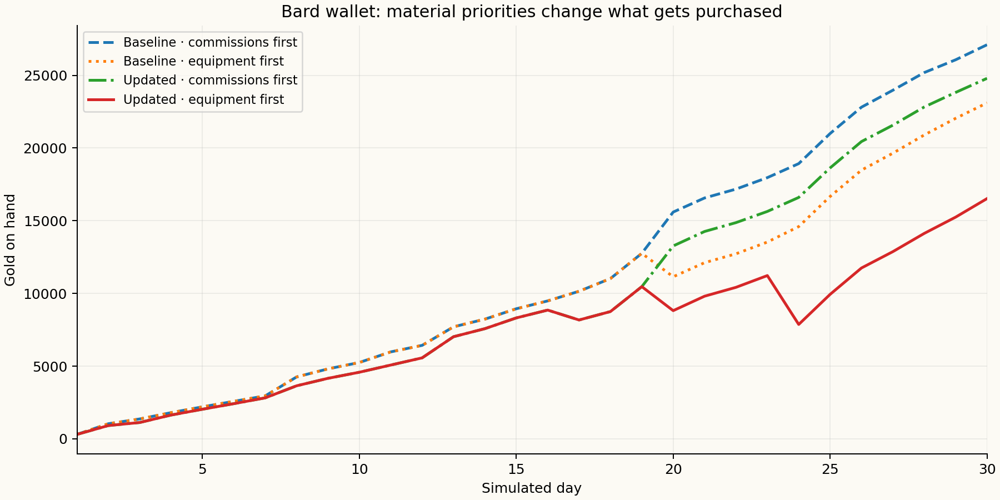

# P08 supply economy report — 1.21.0

Verified **27 October 2026**, America/Denver. These are deterministic simulated accounts, not user outcomes.

The agreed target is **3–5 encounters per day**. The updated moderate fixtures sustain both budgets. This is an attempt budget used by the simulator, **not a new daily cap or proof that larger budgets are impossible**. Exploration remains unrestricted. Full automatic recovery remains local midnight.

## What changed

- Deliberate between-battle potion/ether use, with saved reserves and no revival or free recovery.
- Whole-quantity store purchases that commit gold, inventory and local stock together; no partial batches.
- Full/fallen-target item protection, including battle turns.
- Delivery previews that expose competing smith materials before turn-in.
- One CHA seal recipe per town, adding six accessories at the existing town cost/modifier scale. Base stats and real-world XP are unaffected.

Gold rewards, consumable prices, crafting prices, login rewards, rank thresholds and enemy/companion scaling are unchanged. The comparison includes a new bot policy that deliberately uses carried supplies between battles, plus the new seal recipes. It is not a price-only experiment.

## Method

There are **80 baseline and 80 updated 30-day runs**, with day-7 checkpoints and validated daily backup round trips. Every run reconciles starting-zero wallet + five income sources − supply/equipment purchases to the final wallet. The three starting potions and one ether are recorded as supplies, not income.

The main matrix covers all eight Basic classes × login-only/moderate routines × commission-first/equipment-first material policies × three/five encounter-attempt budgets (64 cases). Twelve sensitivity cases use base-stat fixtures of 30 or 100 for Warrior, Scholar and Bard in campaign or repeat-exploration modes. Four further exploration cases use seeds 13 and 89 for Warrior/Bard; the main seed is 3434.

The moderate routine completes the actual `u-walk-brisk`, `u-spaced-recall` and `u-bible-recall` daily requests through normal acceptance/completion functions. It earns 4,350 player XP and 870 request gold in 30 days. Weekly/monthly, profession and vocation rewards are omitted from this controlled basket; actual users can earn more. The routine is not optimized for each class. Available combat skills are bought with actual earned points, not injected ownership. No exam outcomes or credentials are fabricated.

All primary fixtures start with six base stats at 10, Mira, initial equipment and no gold. The high-stat cases are synthetic sensitivity fixtures, not claims that onboarding assigns rank F to those results. Player XP can strengthen companions even when a class has no relevant practice; this carry effect needs a later combat pass.

A simple tactical policy guards charged rounds, heals living allies, uses signatures/offense, spends available items and retreats at a 160-action safety bound. It stops after a defeat for the day. Exploration can take up to three outings per remaining encounter slot; findings spend outings but do not count as battles. The equipment-first policy preserves materials for preferred stat gear and armor; the commission-first policy turns in eligible deliveries first. Neither policy is forced on players.

## Main results

Equipment-first moderate fixtures, updated build:

| Class | Day 7 wins: 3 / 5 budget | Day 30 wins: 3 / 5 budget | Potion / ether use at 5 | Supply / equipment gold at 5 | Wallet at 5 |
| --- | --- | --- | --- | --- | --- |
| Warrior | 21 / 35 | 90 / 150 | 27 / 47 | 825 / 12,000 | 16,955 |
| Sentinel | 21 / 35 | 90 / 150 | 25 / 45 | 695 / 6,000 | 23,785 |
| Ranger | 21 / 35 | 90 / 150 | 15 / 40 | 570 / 12,000 | 17,210 |
| Rogue | 21 / 35 | 90 / 150 | 15 / 20 | 200 / 12,000 | 17,580 |
| Scholar | 21 / 35 | 90 / 150 | 4 / 8 | 0 / 12,000 | 17,780 |
| Disciple | 21 / 35 | 90 / 150 | 10 / 48 | 770 / 12,000 | 17,010 |
| Bard | 21 / 35 | 90 / 150 | 52 / 46 | 1,260 / 12,000 | 16,520 |
| Artificer | 21 / 35 | 90 / 150 | 12 / 49 | 775 / 12,000 | 17,005 |

All eight updated moderate fixtures win 21/35 encounters at day 7 and 90/150 at day 30 under the three/five budgets. The baseline five-budget Bard loses one attempt; the other moderate equipment-first fixtures already reach 150 wins. These runs do not establish broad combat balance.





## Findings and remaining work

- **Material priorities matter.** In the baseline five-budget Warrior fixture, commission-first behavior spends 3,900 gold on equipment while equipment-first behavior spends 12,000. Higher gold prices would not explain that difference; deliveries compete for crafting materials. The UI now shows the cost before submission.
- **Items have a real cost.** The updated five-budget Bard consumes 52 potions and 46 ethers; its wallet pays 1,260 gold for supplies and 12,000 for equipment. Inventory also includes login supplies and starting stock, so consumed items do not equal purchased items.
- **Login-only is a control, not a recommendation.** It can still earn adventure gold and equipment while real-world XP stays zero. Real-world work remains the route to player/class/profession XP; gold is shared.
- **There is a gold surplus.** Adventures supply roughly 89–90% of gold in the three-budget moderate cases and about 95% in the five-budget cases, under this limited three-daily basket. Weekly/monthly work is excluded. Owner direction is to keep both gold sources and tune spending and material demand; no source is removed in this pass.
- **Higher-stat challenge is unresolved.** Every 30/100 sensitivity fixture wins all 150 allowed attempts. Most Warrior/Scholar sensitivity cases use no consumables. Fixed 50-HP/20-MP items also become a smaller fraction of high-stat reserves. Regional tactics, companion scaling, stronger builds, graded supplies and longer-term material/gold sinks remain P02/P08 work.
- **Campaign breadth is finite.** The 150-win campaign cases can clear 150 of the current 240 stages within a month. Repeat exploration remains available; these runs do not provide a full world-retention model.

No earned balances or progress are removed. This release is a measured supply/use pass, not completion of P08 or a claim that the economy has reached a final balance.

## Reproduce and inspect

```sh
npm run simulate:economy -- --baseline
npm run simulate:economy
python3 scripts/report-economy.py
```

The baseline command reads release commit `76d9167dc198df8758f038b474cd64a4c3524007` into a temporary checkout and overlays only the simulation harness. It requires that commit in the local Git history, uses the repository’s installed dependencies and removes the temporary files when finished. Candidate runs use the current source. Each result records hashes for the actual core source and harness. UUIDs in account exports vary; economic outcomes are seeded.

[Baseline results](baseline/results.json) · [Updated results](candidate/results.json) · [All 4,800 daily observations](daily-progress.csv)

Validated representative final accounts: [Warrior before](baseline/account-warrior.json) / [after](candidate/account-warrior.json), [Bard before](baseline/account-bard.json) / [after](candidate/account-bard.json), [Scholar before](baseline/account-scholar.json) / [after](candidate/account-scholar.json).

[UI fixtures and scans](screens/README.md) · [Changes](../update-1.21.md) · [Verification](../verification-1.21.md) · [Roadmap](../../ROADMAP.md)
