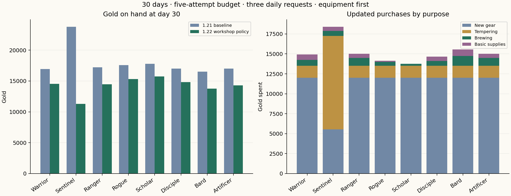
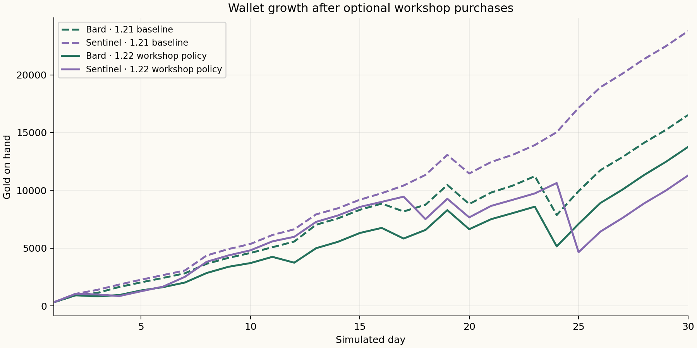

# P08 workshop economy report — 1.22.0

Verified **27 October 2026**, America/Denver. These are deterministic simulated accounts, not observed users.

The new apothecary and tempering bench give gold and materials useful combat effects. All eight moderate, equipment-first classes still meet the **3–5 encounter** scenario budgets. Gold surplus remains; this release does not claim final balance.

## Delivered rules

| Service | Gold | Materials per item | Effect |
| --- | --- | --- | --- |
| Greater potion | 100 | 2 local herbs | Up to max(150 HP, 25% maximum HP) |
| Greater ether | 125 | 2 local herbs | Up to max(60 MP, 25% maximum MP) |
| Royal potion | 400 | 4 local herbs + 1 local smith material | Up to max(450 HP, 50% maximum HP) |
| Royal ether | 500 | 4 local herbs + 1 local smith material | Up to max(180 MP, 50% maximum MP) |

Greater brews are available in every accessible town; Royal brews require an Adept or better town. Percentage amounts round down. Batches use whole quantities 1–99 and commit the complete gold/material/item exchange together. Brewing is separate from the general store’s stock. Full/fallen targets cannot consume supplies. Carried brews appear in both field Supplies and battle commands; a valid battle item spends a turn.

Owned town equipment can be tempered at its original smith to +5. For next rank n, the gold cost is original gear price × 2^n and material cost is original recipe quantity + n. Each rank adds ceil(original modifier × 0.15) to the item’s combat modifier. For example, Woodland Blade goes from +3 STR to +4 at +1 for 300 gold and 3 Softwood; +2 costs 600 gold and 4 Softwood. Rank five is an item upgrade limit, not a player/stat cap.

Ranks persist when equipment is removed and in backups. Upgrades do not grant base stats, real-world XP, health or mana. Manual item recovery is saved; automatic full recovery remains local midnight. General-store prices, both gold sources, login rewards, request XP, rank thresholds and enemy/companion scaling are unchanged. Delivery previews now also expose lost coverage for brews and owned-item upgrades. Trades appraisals compare the actual tempered equipment; Healthcare triage includes carried brews.

## Simulation method

The comparison reruns **80 baseline and 80 updated 30-day accounts**, covering 4,800 account-days with day-7 checkpoints. Baseline source is release `f1d3ad850c91896c829831c9f7b53e048296c44f` (1.21); both phases deliberately use carried supplies between battles. The same current harness is overlaid on the archived baseline. It uses fixed local noon dates starting 1 February 2027, America/Denver, and seeded exploration. Gold reconciles and character saves validate every day.

The 64-case main matrix covers eight Basic classes × login-only/moderate work × commission-first/equipment-first priorities × three/five encounter-attempt budgets. Twelve sensitivity fixtures use Warrior/Scholar/Bard at base stats 30/100 in campaign/exploration modes; four extra exploration cases vary Warrior/Bard seeds. Synthetic high-stat F flags are fixture settings, not onboarding placement. Attempts are simulation budgets, not product limits; exploration stays unrestricted.

The moderate basket is the same three actual daily requests: brisk walking, spaced recall and Bible recall. It earns 4,350 real player XP and 870 gold in 30 days. Weekly/monthly, profession and vocation rewards are omitted. Login-only controls earn no real-world XP. Class exams, certifications and base-stat rewards are not fabricated. Skills use legitimately earned points.

The updated bot buys stronger regional gear, preserves a 65-gold supply reserve and invests in at most two temper ranks on relevant current-town equipment. It brews one carried stronger item when a living member has at least 100 missing HP or 40 missing MP, choosing Royal above 300/120 if available. It chooses the carried item with the closest restoration amount, guards charged attacks and uses healing, signatures and learned attacks. Equipment-first behavior reserves materials for the next eligible upgrade; commission-first behavior does not. It does not deliberately revisit old smiths, optimize item builds, maximize potion use or buy all five temper ranks. These changed choices mean this is not a price-only experiment.

## Results

Moderate, equipment-first fixtures; values are cumulative at day 30.

| Class | Day 7 wins (3 / 5) | Day 30 wins (3 / 5) | Wallet before → after (5) | Tempering / brewing gold (5) | Basic supply gold before → after (5) |
| --- | --- | --- | --- | --- | --- |
| Warrior | 21 / 35 | 90 / 150 | 16,955 → 14,550 | 1,500 / 750 | 825 → 680 |
| Sentinel | 21 / 35 | 90 / 150 | 23,785 → 11,285 | 11,700 / 625 | 695 → 520 |
| Ranger | 21 / 35 | 90 / 150 | 17,210 → 14,465 | 1,500 / 1,000 | 570 → 515 |
| Rogue | 21 / 35 | 90 / 150 | 17,580 → 15,330 | 1,500 / 500 | 200 → 150 |
| Scholar | 21 / 35 | 90 / 150 | 17,780 → 15,730 | 1,500 / 250 | 0 → 0 |
| Disciple | 21 / 35 | 90 / 150 | 17,010 → 14,810 | 1,500 / 625 | 770 → 545 |
| Bard | 21 / 35 | 90 / 150 | 16,520 → 13,755 | 1,500 / 1,250 | 1,260 → 815 |
| Artificer | 21 / 35 | 90 / 150 | 17,005 → 14,295 | 1,500 / 1,000 | 775 → 525 |





## Interpretation and remaining work

- All eight updated moderate fixtures win 21/35 attempts at day 7 and 90/150 at day 30 under three/five budgets. Existing 1.21 source already sustained those moderate budgets. Workshop purchases are useful options, not established requirements for playing.
- Day-30 five-budget wallets fall to 11,285–15,730 gold from 16,520–23,785 in the comparable baseline. Changes include spending, altered battle behavior and fewer material deliveries; the wallet difference is not all a new gold sink.
- Sentinel spends 11,700 on tempering versus 1,500 for most other classes and buys 5,550 of new gear versus 6,000 before. A tempered piece can postpone a replacement. Material access, current-town restrictions and build choices affect the result; one mandatory spending curve would hide these differences.
- Most moderate fixtures use Greater ethers, not Greater/Royal potions. All eight five-budget cases consume zero Royal supplies. The stronger recipes function in tests but this matrix does not establish high-grade demand. More difficult optional battles remain necessary before claiming a late-game consumable economy.
- Equipment-first exploration can retain materials for upgrades while commission-first behavior repeatedly sells them. Revisit-town and long-term material strategies remain unmodeled. `materialsSpent` in raw results counts workshop consumption only; it does not include forging or deliveries.
- All twelve synthetic 30/100-stat cases still win all 150 attempts. Companions still scale with player XP, and fixed regional encounters become easy. This pass preserves enemy strength and earned power; higher-stat challenge remains P02/P08.
- Both gold sources and unrestricted exploration are retained. The simulation still has excess gold, excludes larger calendar/career rewards, and can clear 150 of 240 campaign stages in a month. It is not a retention forecast.

## Reproduce and inspect

```sh
npm run simulate:economy -- --workshop --baseline
npm run simulate:economy -- --workshop
python3 scripts/report-workshop.py
```

The baseline commit must exist locally. The script archives only source/configuration into a temporary directory, overlays the simulation harness, reuses installed dependencies and removes the temporary directory. Raw results record actual core-source and harness hashes; UUIDs vary, economic outcomes are seeded.

[Baseline results](baseline/results.json) · [Updated results](candidate/results.json) · [4,800 daily observations](daily-progress.csv)

Representative validated accounts: [Warrior before](baseline/account-warrior.json) / [after](candidate/account-warrior.json), [Bard before](baseline/account-bard.json) / [after](candidate/account-bard.json), [Scholar before](baseline/account-scholar.json) / [after](candidate/account-scholar.json).

[Previews and scans](screens/README.md) · [Changes](../update-1.22.md) · [Verification](../verification-1.22.md) · [Roadmap](../../ROADMAP.md)
