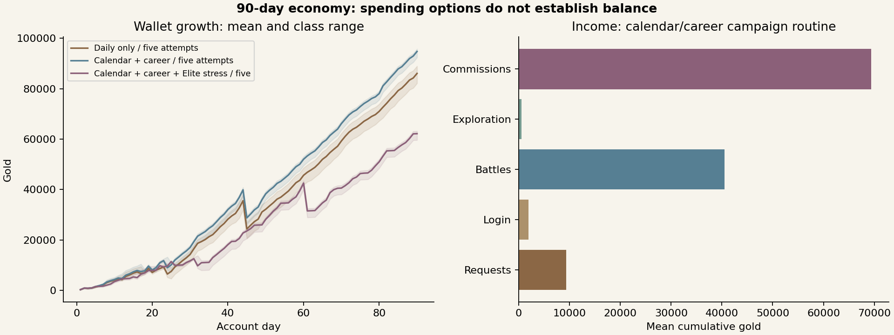

# Ninety-day economy report — 1.24.0

Verified **27 October 2026**, America/Denver. These are deterministic modeled accounts, not measured adherence or personal records.

**Gold surplus remains.** Calendar/career work supports faster player progression, and ordinary campaign fixtures generally sustain their five-attempt budgets. Repeatedly choosing the furthest unlocked region’s Elite hunt is a losing stress case for these starter-stat, Mira-only parties. It is not a recommended routine or a product encounter cap.

## Method

Thirty-two accounts cover all eight Basic classes. Each class has a five-attempt daily-only control, five-attempt calendar/career campaign routine, five-attempt calendar/career Elite-hunt stress routine, and a three-attempt version of that stress routine. Each runs **90 days**, from 1 February through 1 May 2027 at device-local noon in America/Denver. There are **2,880 account-days**, with checkpoints at days 7, 30, 60 and 90. Every daily save validates and every gold balance reconciles to actual income less spending.

All start at F rank, all base attributes 10, starter supplies/gear and Mira. No XP, gold, skill ownership or consumable stock is injected. Logins are claimed explicitly. The daily basket is a thirty-minute brisk walk, spaced recall and fifteen-minute Scripture comprehension. The richer routine additionally models twenty-minute Networking vocation practice on six days per week, alongside an Analyst profession. It is a specific career scenario, not coverage of all twenty disciplines.

Walking and Scripture F weekly/monthly requests and Networking weekly/monthly requests are explicitly accepted again in each calendar period. Daily receipts feed their real calendar/session gates. Project/checklist completion is assumed reported once eligible: this models doing the described work, rather than verifying a real work sample. No class or profession exam passes, certifications or prestige promotions are fabricated. The basket also omits class-specific training requests, so many martial/elemental paths remain unearned. Consequently exam-gated progression remains constrained; this is not a forecast for someone training a class and passing every five-level exam.

The same deterministic equipment-first purchasing policy buys currently useful town gear, keeps a 65-gold reserve, tempers relevant owned gear to at most +2, buys basic supplies and brews stronger supplies when missing HP/MP meets its thresholds. All stock, materials and currency are earned and consumed through actual transactions. It does not test full +5 investment, deliberate workshop revisits, optimal builds, every career reward, or unlimited demand. Supplies are used between and during battles; automatic full recovery remains local midnight. The party remains hero plus Mira; this does not model recruiting Orin or optimizing a three-member party.

The hunt stress policy spends the first outing on each eligible weekend day attempting an Elite-grade hunt in the furthest region whose outer route is cleared. A defeat stops that day’s outings. It does not retreat from a known bad matchup, downgrade to Veteran or wait for better preparation. Selecting later unlocked regions raises difficulty by authored region strength; enemies never scale to player stats. Other days follow the next campaign stage, then existing exploration.

## Results

| Routine | Day-90 wallet range | Wins / 90 days | Defeats, all eight classes | Final guild rank |
| --- | --- | --- | --- | --- |
| Daily only · five | 82,215–89,000 | 449–450 | 2 | D (Bronze) |
| Calendar/career · five | 92,425–95,800 | 450–450 | 0 | C (Iron) |
| Elite stress · five | 59,640–63,220 | 325–325 | 200 | C (Iron) |
| Elite stress · three | 34,815–38,185 | 195–195 | 200 | C (Iron) |



The calendar/career basket earns **9,310 request gold**: 2,610 from the daily universal basket, 208 from universal weeklies, 216 from universal monthlies and 6,276 from career requests of all cadences. These classifications are disjoint. Its final receipts include 348 dailies, 39 weeklies and nine monthlies. The daily-only control earns 2,610 request gold and completes 270 dailies. Login income is 1,965 gold in every account.

In the no-hunt calendar/career accounts, all classes win 450 encounters. The daily-only group has two defeats in total; two classes finish with 449 wins instead of 450. Daily-only characters finish at player level 16 / D rank; calendar/career characters reach player level 33 / C rank. Player level remains separate from class/profession/vocation levels. This is ninety-day evidence only, not proof of the nine-to-twelve-month A-rank target.

Each Elite stress account attempts 25 hunts and wins none. The five-attempt versions win 325 normal fights; three-attempt versions win 195. The first failed hunt ends an outing day, which explains much of their smaller wallets. The policy’s defeats are not evidence that every player or class needs a nerf or buff: it ignores easier grades and additional companions.

No account uses a Royal supply, and no combat loop reaches the action bound. Greater and basic items do get purchased/used, but finite demand remains. Failure and gold surplus coexist: spending basic gold cannot revive a fallen party member or replace the need for a suitable party/build.

## Implications

- Keep both real-world and Adventure gold sources, as requested. Real-world work adds valuable player progression; the study does not justify cutting request rewards to fix a primarily Adventure-income surplus.
- Repeat commission deliveries and battle income remain the largest sources. A finite set of gear purchases and conservative +2 upgrades does not create sustained spending demand. The bot leaves possible +3–+5 spending unexplored, so its wallet is not a measurement of the best available shopping strategy.
- Model prepared Veteran-to-Elite progression, additional companions, material routing and deliberate smith revisits before calling high-grade supply demand sustainable. These stress fixtures fail too early to demonstrate a healthy Royal market.
- Do not force harder hunts or add automatic recovery to consume the surplus. Preserve fixed encounter strength, manual choices, companion-led play and midnight recovery.
- Next P08 experiments should compare repeated meaningful services/long-term material goals and richer purchase policies over 180–365 days. Broader P01/P02 prestige/loadout and normal-region tactics remain open.

## Reproduce and inspect

```sh
npm run simulate:long-economy
python3 scripts/report-long-economy.py
```

[Raw results and source hashes](results.json) · [2,880 daily observations](daily-progress.csv) · [Warrior account](account-warrior.json) · [Scholar account](account-scholar.json) · [Bard account](account-bard.json)

[Combat build comparison](../builds-1.24/README.md) · [Earlier thirty-day economy comparison](../economy-1.22/README.md) · [Changes](../update-1.24.md) · [Roadmap](../../ROADMAP.md)
