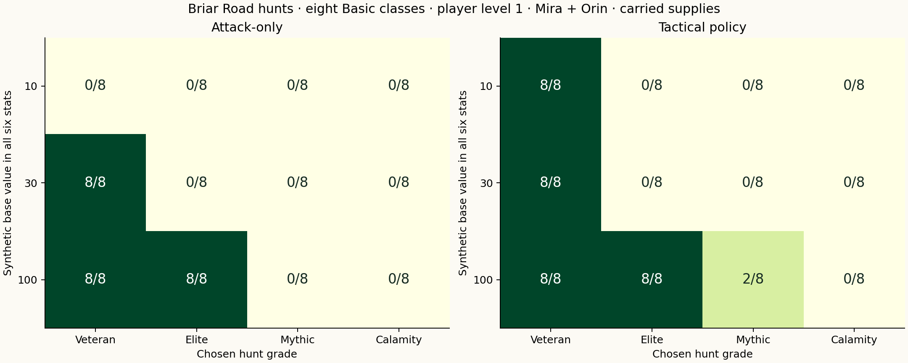
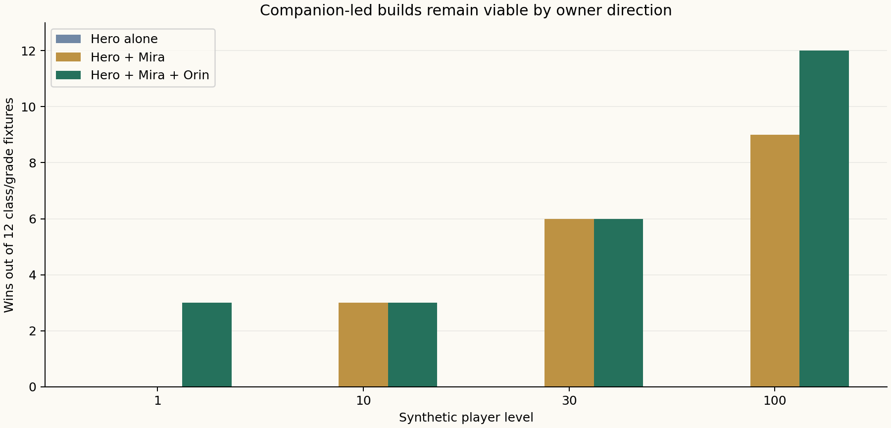

# Elite hunts and companion tactics — 1.23.0

Verified **27 October 2026**, America/Denver. These are deterministic synthetic combat fixtures, not real users or earned-account progression simulations.

## What ships

There are **32 optional hunts**, four fixed grades in each of eight regions: Veteran, Elite, Mythic and Calamity. Clear the region’s ten-stage outer route to enter. The board shows one selected encounter, enemy reserves, attack/defense, tactics, gold and local brewing/smith materials. Strength depends on region and chosen grade; it does not scale automatically to the current party. Normal stage enemies, the 240-stage campaign, discovery/ambush rules, rank curves and existing economy prices are unchanged.

Hunts use existing persistent party HP/MP. Hunt again claims an unpaid victory exactly once and starts the same hunt without recovery; Hunt board claims once and returns to the selected hunt. Damage, used supplies and nearby roaming-boss state survive retreat/reload. Local midnight remains the automatic full recovery. Hunts award no real-world XP or base stats. Their kills can legitimately count toward already accepted matching monster commissions; they do not count as roaming-boss victories.

| Enemy pattern | Visible rule | Useful response |
| --- | --- | --- |
| Ironhide | Shell reforms every fourth round | Shell-breaking techniques, magic, analysis or finishing before reform |
| Bloodtrail | Targets the lowest living HP percentage | Guard the threatened member, heal or taunt |
| Mana Reaver | Targets highest MP; siphons every second round | Guard reduces drain by 75%; taunt can redirect |
| Frenzy | Party cleave every third round; +30% damage at 40% HP or less | Party protection and timed offense |

Companions keep their player-level growth and old signatures. Mira retains Restore/Glimmer; Orin adds party protection/taunt, Lyra piercing shots, Gideon shell/defense analysis, Nessa group healing, Toma burning and Elara guarded counters. These complementary commands appear in newly created fights; older saved battles keep their existing command lists. No companion stats are reduced.

**Owner direction:** companion-led success remains a valid route for support- and career-focused characters. Do not treat carry as an exploit to remove. Continue improving roles and tactics while preserving that route.

## Probe method

The matrix contains **1,568 independent battles**, with a fixed 1 February 2027 local-noon clock and a 160-action safety bound. Every final battle/character JSON validates, every gold payout matches the actual encounter, and real-world XP/base stats remain unchanged. All probes end in a win or defeat; none hits the action bound.

- **768 primary fixtures:** eight Basic classes × all-stat values 10/30/100 × four grades × Attack-only/tactical × solo/trio × empty/carried supplies, in Mossfall.
- **504 regional fixtures:** Warrior/Scholar/Bard × three all-stat values × four grades × two supply conditions × seven later regions, with tactical play and Mira/Orin.
- **144 companion fixtures:** Warrior/Scholar/Bard × player levels 1/10/30/100 × solo/Mira/trio × four grades, at base stats 10 without supplies.
- **128 learned-loadout fixtures:** eight classes × all-stat values 30/100 × four grades × two supply conditions, tactical trio.
- **24 focused-stat fixtures:** Warrior/Scholar/Bard × four grades × signature-only/learned, main stat 100, CON 30 and other stats 10, tactical trio with supplies.

All are synthetic snapshots. Region access is explicitly granted for the experiment, player levels use synthetic retained-XP credits, and learned loadouts are injected catalog nodes rather than acquired through simulated tasks/exams. Equipment remains the starter sword/clothes. Initial supplies are either empty or two of each basic/Greater item and four of each Royal item; no crafting/purchase acquisition is simulated. Fixtures do not represent a validated assessment assigning those stats or an ordinary first-day character.

Attack-only uses Attack and leaves carried items unused. The tactical bot guards charged rounds, uses available party protection, prioritizes critical HP items/healing, opens with analysis, uses first-round buffs and chooses offense by one-action damage prediction with a small MP-cost penalty. It selects the carried supply whose power is closest to the current deficit. This deterministic bot knows the rules and is not proof of optimal play, the best build, human difficulty or a daily encounter budget.

## Results

Mossfall, level-1 trio with carried supplies, signature-only hero. Each cell is wins out of eight Basic classes.

| All six base stats | Policy | Veteran | Elite | Mythic | Calamity |
| --- | --- | --- | --- | --- | --- |
| 10 | Attack | 0/8 | 0/8 | 0/8 | 0/8 |
| 10 | Tactical | 8/8 | 0/8 | 0/8 | 0/8 |
| 30 | Attack | 8/8 | 0/8 | 0/8 | 0/8 |
| 30 | Tactical | 8/8 | 0/8 | 0/8 | 0/8 |
| 100 | Attack | 8/8 | 8/8 | 0/8 | 0/8 |
| 100 | Tactical | 8/8 | 8/8 | 2/8 | 0/8 |



Learned-loadout trio, tactical policy and carried supplies:

| All six base stats | Veteran | Elite | Mythic | Calamity |
| --- | --- | --- | --- | --- |
| 30 | 8/8 | 0/8 | 0/8 | 0/8 |
| 100 | 8/8 | 8/8 | 1/8 | 0/8 |



## Interpretation and limits

- Fixed higher grades stop high-stat snapshots from automatically clearing every available challenge while ordinary enemies remain unchanged. In these level-1 trio fixtures, Calamity defeats every tested Basic class even with carried supplies. This does not establish that Calamity is impossible for stronger equipment, higher player levels, prestige classes or better play.
- At base stats 10, all eight primary tactical trios with supplied items clear Veteran; their Attack-only counterparts do not. This demonstrates an actionable guard/skill/item difference under this policy, not a claim that every fresh character should attempt a hunt.
- Across the whole matrix, 233 Royal potions and 0 Royal ethers are consumed. Finite preloaded inventory can force expensive-item use after cheaper stock empties. This is combat-use evidence, **not a measured purchase demand, sustainable economy or proof of a daily routine**.
- Player-level companions remain powerful. The level-100 trio fixtures clear all four Mossfall grades with base-stat-10 heroes under this policy. The owner explicitly chose to keep companion-led builds valid. Growth is preserved; the new commands add protection, analysis, damage-over-time and recovery choices.
- Focused-stat and learned-loadout cases show why an all-stat-100 fixture is not a representative class build. Raw results include defeats and cases where the chosen learned loadout does not improve the outcome. More careful prestige/loadout, element/weapon and party-composition tuning remains P01/P02.
- Existing 1.22 economy findings still apply: gold surplus and calendar/career-inclusive long-term spending need further work. These independent fights do not replace the 7-/30-day earned-account studies or establish the three/five-encounter daily target for elite hunting.
- No new real-world XP, guild rank, login reward, supply price, temper price or stat reward is granted by this pass. Physical Android, live Google/Firebase, broader performance, authored world stories and deeper career workflows remain open.

## Reproduce

```sh
npm run simulate:hunts
python3 scripts/report-hunts.py
```

[Raw fixtures and source hashes](results.json) · [Compact CSV](probes.csv) · [UI fixtures and scans](screens/README.md) · [Changes](../update-1.23.md) · [Verification](../verification-1.23.md) · [Roadmap](../../ROADMAP.md)
