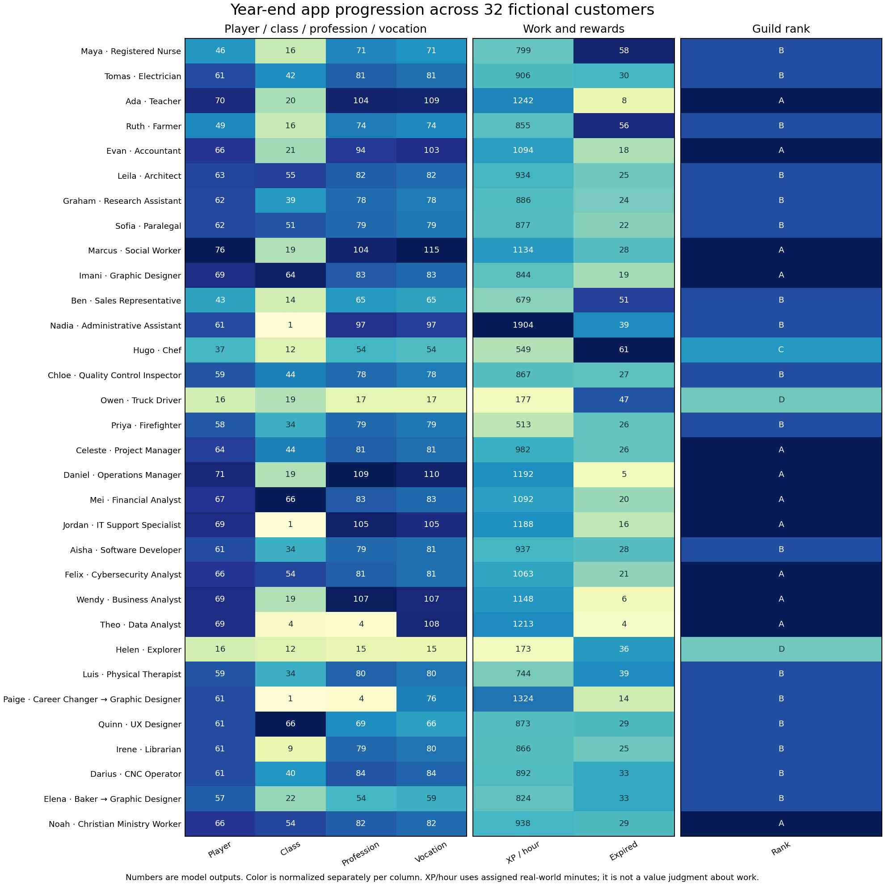
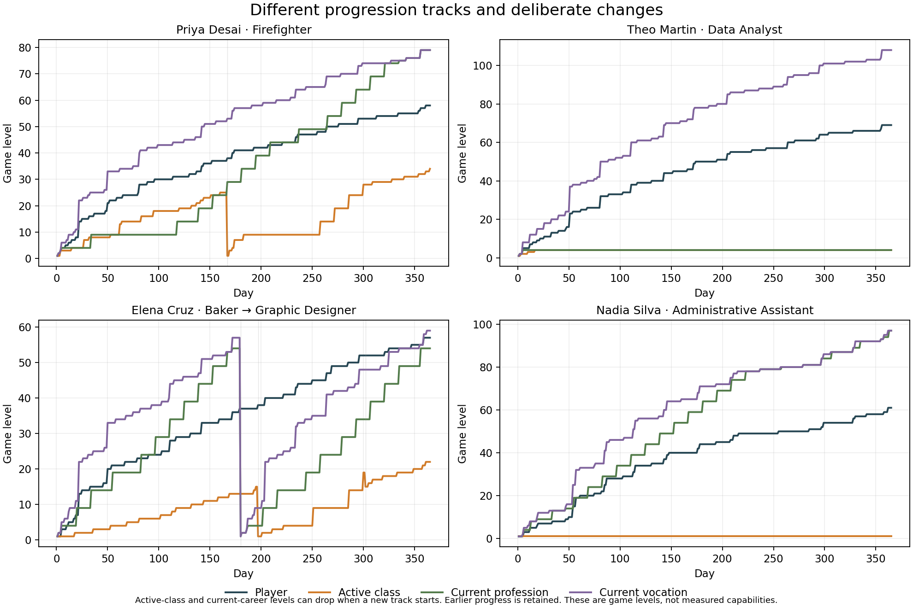

# One year with 32 different fictional customers

**32 customers, 32 starting professions, all 20 profession categories, all 25 vocations, 28 classes used, and 35 annual scenarios.** Three scenarios are matched alternatives for existing customers, not additional people. The app processed **12,775 account-days** and **23,315 completed requests**.

The app supports much more than the original Analyst/Networking use case. Its career trees and retained histories work across healthcare, teaching, trades, farming, law, logistics, creative work, service and other fields. The main problems are progression clarity, a confirmed Network Weaver scope defect, uneven rewards for different schedules, and limited later career-skill spending.

**These are fictional profiles and scripted work/exam inputs run through the app’s real domain functions. They are not customer interviews, retention measurements, predicted fitness gains or evidence of professional competence.** The interpretation of each experience is a hypothesis grounded in its trace.

[All complete profiles in one document](CUSTOMERS.md) · [Methods and assumptions](METHOD.md) · [Priority findings](PRIORITIES.md) · [Raw summary CSV](summary.csv) · [Day 7/30/90/180/365 checkpoints](checkpoints.csv)

## At a glance

- All eight Basic classes and Monk were used at registration. Later paths brought observed class coverage to **28 of 51** definitions; all 20 category-specific career tools became available somewhere in the cohort.
- **11 of 32** primary profiles entered a prestige class; first entries ranged from day **95 to 312**. No Ascendant entry was chosen in these routines. Tomas qualifies to take World Forger’s trial, and Felix/Darius qualify for Phantom’s trial; those were beyond their declared goals.
- **12 of 32** reached A/Gold within the year, between days **258 and 348**. Median among those achievers was **325 days**. The other 20 did not reach A; this is not a cohort-wide nine-to-twelve-month forecast.
- Player levels ended at **16–76**; profession levels at **4–109**. Vocation levels were **15–115** and are not exam-gated.
- All **5,543 ordinary encounter attempts** were won with the shared policy, learned builds, actual purchases and available companions. This is evidence of accessible ordinary progression in these scenarios, not Elite-hunt balance or class equality.
- **995 accepted commitments expired** across the 35 runs. Earned XP and earlier histories were retained. There were **479 rejected duplicate reward attempts**, no combat action-bound cases, and daily gold reconciliation passed.

## The customers

Each linked profile includes backstory, goals, constraints, equipment, schedule, concrete career work, five checkpoints, retained class/profession history, stats, skills, Adventure outcomes and an experience assessment. Paige and Elena change careers; the year-end numbers describe their current tracks, while their earlier roles remain in the profile history.

| Customer / age | Starting profession → vocation | Starting → year-end class | Player / class / profession / vocation levels | Rank |
| --- | --- | --- | --- | --- |
| [Maya Ortiz / 29](profiles/maya.md) | Registered Nurse → Healthcare | Sentinel → Healer | 46 / 16 / 71 / 71 | B |
| [Tomas Vega / 42](profiles/tomas.md) | Electrician → Construction | Artificer → Grand Artificer | 61 / 42 / 81 / 81 | B |
| [Ada Bennett / 34](profiles/ada.md) | Teacher → Education | Bard → Bard | 70 / 20 / 104 / 109 | A |
| [Ruth Okafor / 51](profiles/ruth.md) | Farmer → Land, Agriculture | Ranger → Ranger | 49 / 16 / 74 / 74 | B |
| [Evan Park / 38](profiles/evan.md) | Accountant → Accounting | Scholar → Scholar | 66 / 21 / 94 / 103 | A |
| [Leila Haddad / 27](profiles/leila.md) | Architect → Engineering | Artificer → Engineer | 63 / 55 / 82 / 82 | B |
| [Graham Ellis / 23](profiles/graham.md) | Research Assistant → Science | Scholar → Sage | 62 / 39 / 78 / 78 | B |
| [Sofia Marin / 31](profiles/sofia.md) | Paralegal → Law | Rogue → Tactician | 62 / 51 / 79 / 79 | B |
| [Marcus Reed / 46](profiles/marcus.md) | Social Worker → Community | Disciple → High Cleric | 76 / 19 / 104 / 115 | A |
| [Imani Brooks / 26](profiles/imani.md) | Graphic Designer → Arts, Design | Bard → Minstrel | 69 / 64 / 83 / 83 | A |
| [Ben Wallace / 41](profiles/ben.md) | Sales Representative → Sales | Bard → Marshal | 43 / 14 / 65 / 65 | B |
| [Nadia Silva / 36](profiles/nadia.md) | Administrative Assistant → Administration | Sentinel → Sentinel | 61 / 1 / 97 / 97 | B |
| [Hugo Laurent / 33](profiles/hugo.md) | Chef → Hospitality | Warrior → Disciple | 37 / 12 / 54 / 54 | C |
| [Chloe Nguyen / 24](profiles/chloe.md) | Quality Control Inspector → Manufacturing | Rogue → Duelist | 59 / 44 / 78 / 78 | B |
| [Owen Price / 54](profiles/owen.md) | Truck Driver → Transport | Sentinel → Sentinel | 16 / 19 / 17 / 17 | D |
| [Priya Desai / 30](profiles/priya.md) | Firefighter → Safety | Warrior → Champion | 58 / 34 / 79 / 79 | B |
| [Celeste Morgan / 39](profiles/celeste.md) | Project Manager → Project Management | Bard → Guild Strategist | 64 / 44 / 81 / 81 | A |
| [Daniel Cho / 44](profiles/daniel.md) | Operations Manager → Operations | Sentinel → Marshal | 71 / 19 / 109 / 110 | A |
| [Mei Tan / 28](profiles/mei.md) | Financial Analyst → Financial Analysis | Scholar → Elementalist | 67 / 66 / 83 / 83 | A |
| [Jordan Foster / 32](profiles/jordan.md) | IT Support Specialist → Networking | Artificer → Network Weaver | 69 / 1 / 105 / 105 | A |
| [Aisha Rahman / 25](profiles/aisha.md) | Software Developer → Software Development | Scholar → Archmage | 61 / 34 / 79 / 81 | B |
| [Felix Romero / 35](profiles/felix.md) | Cybersecurity Analyst → Cybersecurity | Rogue → Shadowblade | 66 / 54 / 81 / 81 | A |
| [Wendy Mensah / 47](profiles/wendy.md) | Business Analyst → Business Analysis | Bard → Battle Analyst | 69 / 19 / 107 / 107 | A |
| [Theo Martin / 22](profiles/theo.md) | Data Analyst → Data Analysis | Scholar → Scholar | 69 / 4 / 4 / 108 | A |
| [Helen Ward / 68](profiles/helen.md) | Explorer → Exploration | Disciple → Scripture Scribe | 16 / 12 / 15 / 15 | D |
| [Luis Alvarez / 37](profiles/luis.md) | Physical Therapist → Healthcare | Monk → Warpriest | 59 / 34 / 80 / 80 | B |
| [Paige Sato / 21](profiles/paige.md) | Career Changer → Exploration | Bard → Bard | 61 / 1 / 4 / 76 | B |
| [Quinn Harper / 28](profiles/quinn.md) | UX Designer → Software Development | Bard → Scholar | 61 / 66 / 69 / 66 | B |
| [Irene Patel / 58](profiles/irene.md) | Librarian → Education | Scholar → Sage | 61 / 9 / 79 / 80 | B |
| [Darius Bell / 40](profiles/darius.md) | CNC Operator → Manufacturing | Rogue → Shadowblade | 61 / 40 / 84 / 84 | B |
| [Elena Cruz / 31](profiles/elena.md) | Baker → Hospitality | Warrior → Warrior | 57 / 22 / 54 / 59 | B |
| [Noah Williams / 43](profiles/noah.md) | Christian Ministry Worker → Community | Disciple → High Cleric | 66 / 54 / 82 / 82 | A |

## Experiences worth reading first

### Maya Ortiz: Registered Nurse

[Full profile](profiles/maya.md). Year end: player **46**, **Healer 16**, profession **71**, vocation **71**. Her care work gives her a relevant career tree and a healing identity. The shift pattern also leaves accepted calendar goals unfinished. A useful next-action view should distinguish that from losing earned progress; neither the missed rota nor her old Sentinel level should be framed as a personal failure.

### Tomas Vega: Electrician

[Full profile](profiles/tomas.md). Year end: player **61**, **Grand Artificer 42**, profession **81**, vocation **81**. This is a meaningful non-IT technical path: electrical learning unlocks the trades tool while class work develops Artificer. His professional DEX exam and the INT focus of his class are different checks. The app should explain that split and should never imply that a game level licenses electrical work.

### Ada Bennett: Teacher

[Full profile](profiles/ada.md). Year end: player **70**, **Bard 20**, profession **104**, vocation **109**. Teaching preparation is rewarded strongly, but a high player/profession level does not substitute for Bard class work. Her Maestro aspiration can remain distant despite an impressive guild card. The app needs to show the next relevant class commitment, rather than only recommending more work in the already fast-growing career.

### Ruth Okafor: Farmer

[Full profile](profiles/ruth.md). Year end: player **49**, **Ranger 16**, profession **74**, vocation **74**. Seasonal availability matters more than a daily streak. Her gathered-resource tool fits the farming fantasy, while the model retains all earlier work through harvest. A plan that shows which quests fit the remaining season would serve her better than treating every calendar period as interchangeable.

### Hugo Laurent: Chef

[Full profile](profiles/hugo.md). Year end: player **37**, **Disciple 12**, profession **54**, vocation **54**. Paladin requires both the named predecessor levels and higher STR/WIS values. His kitchen career mainly grows DEX, so those requirements are not automatically satisfied by professional progress. The long route is real in this scenario; meeting the class-level prerequisites alone is not the end of the promotion.

### Priya Desai: Firefighter

[Full profile](profiles/priya.md). Year end: player **58**, **Champion 34**, profession **79**, vocation **79**. The trace shows the requested vertical pattern: earned Warrior history, a Champion trial, then Champion level 1 beside a much higher player level. Physical exam plateaus can delay the next milestone even with banked XP. Earlier mastery and the later maintenance route should be easy to inspect.

### Nadia Silva: Administrative Assistant

[Full profile](profiles/nadia.md). Year end: player **61**, **Sentinel 1**, profession **97**, vocation **97**. This is a viable career-first player with a nearly untouched combat class. The schedule usually spends the available block on vocation work, leaving no time for Sentinel practice. The UI should show that deliberate tradeoff and banked class XP; a class level of 1 does not mean the account has made no progress.

### Owen Price: Truck Driver

[Full profile](profiles/owen.md). Year end: player **16**, **Sentinel 19**, profession **17**, vocation **17**. His short windows still produce retained progress, but splitting them across conditioning and career work misses many calendar thresholds. That is a schedule/reward issue to inspect, not evidence that the work is worthless. The logistics tool is available once he deliberately reviews skills on a day he actually uses the app.

### Elena Cruz: Baker

[Full profile](profiles/elena.md). Year end: player **57**, **Warrior 22**, profession **54**, vocation **59**. The career change keeps Baker history while giving Graphic Designer its own level and a second utility. The new role level is lower than the no-change counterfactual, as expected when practice is split between careers. The app should present that as retained breadth rather than erased progress.

### Quinn Harper: UX Designer

[Full profile](profiles/quinn.md). Year end: player **61**, **Scholar 66**, profession **69**, vocation **66**. A software vocation can earn technology-tree progress while the selected profession remains UX Designer. Engineer still checks the profession category. The same vocation receipts also add XP to the current profession, so credit destinations need clearer design and labeling rather than an unexplained locked-class message.

### Helen Ward: Explorer

[Full profile](profiles/helen.md). Year end: player **16**, **Scripture Scribe 12**, profession **15**, vocation **15**. The modest numerical result is compatible with her modest goal. She can keep short walks, learning and Scripture practice without becoming an intensive player. Clear terminology, a readable card and attainable commitments matter more to this persona than a larger combat rotation.

### Jordan Foster: IT Support Specialist

[Full profile](profiles/jordan.md). Year end: player **69**, **Network Weaver 1**, profession **105**, vocation **105**. His credential is explicitly assumed and self-recorded. The severe issue comes afterward: Network Weaver requests are assigned to the profession scope, so repeated intended class commissions never advance class work. This is a reproduced request-classification defect, not an exam choice or lack of effort.

## The matched alternatives

| Same customer, altered choice | Result |
| --- | --- |
| Theo takes milestone reviews | Player level, XP, requests and gold match the no-exam run. Scholar **4 → 20**; Data Analyst **4 → 104**. INT **19 → 263** is a game-stat effect, not an observed cognitive gain. |
| Elena keeps Baker instead of changing career | No-change Baker ends at **83**. The change run retains Baker **57** and adds Graphic Designer **54**, with two learned career utilities. |
| Maya skips Adventures | All five checkpoints have identical player XP, stats, class, profession and vocation progression. Wallet: **12,544** with Adventures versus **21,607** without; the shopping policy spends more than its added Adventure income in this particular route. Required hybrid quests were not selected. |

## What this says about the app

The strongest fit is a person who enjoys persistent RPG progress and deliberately chooses a manageable set of real-world work. Career-focused support play is viable: Nadia’s player/profession progression and companion-supported battles continue while Sentinel remains 1. Helen’s smaller outcome is still a usable low-intensity routine; an A-rank badge is not required for her stated success.

The weakest part is explaining what a large number means. Player, class, profession, vocation, skill-wallet and assessed-performance tracks can diverge sharply. A high vocation level does not pass a class exam; a high advanced class does not necessarily satisfy a basic-class prestige prerequisite; cross-category vocation work can credit a different selected profession. Those distinctions need direct labels and actionable next steps.

Reward yield also depends heavily on whether a schedule crosses calendar thresholds. The annual XP-per-assigned-hour range is about **173–1904**. The personas differ in task rank, focus and acceptance policy, so this is a diagnostic spread, not a controlled value comparison between occupations. It warrants a matched effort/schedule balance study.

The profession catalogue is broad enough for this cohort, but the detailed role assignments were authored for the study. The app supplies category guidance rather than all 32 individualized professional curricula; these outcomes assume the actor has chosen useful work. Later depth is the clearer issue: saved Maya, Priya and Noah accounts have bought every current node in their respective 12-node modern career sets while retaining hundreds of career points. Some other sampled wallets have no currently learnable node despite a large balance. More job titles alone would not solve that.

Ordinary battles remain accessible under this moderate, two-day-per-week Adventure policy. More demanding matchups, Elite-hunt choices, player-specific tactics and long-form world narrative need separate evaluation. These results do not justify weakening companion-led builds or restoring HP/MP after every encounter.

[Prioritized evidence](PRIORITIES.md) · [Mechanics reproductions](mechanics-probes.json) · [All raw results and source hashes](results.json) · [Daily records](daily-progress.csv) · [Standalone cohort figure](cohort.svg) · [Standalone journey figure](journeys.svg)

The APK and app rules remain version 1.25.0. This study changes no balances or live user data.
