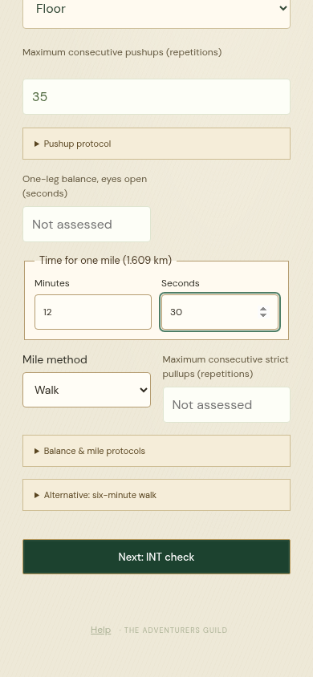
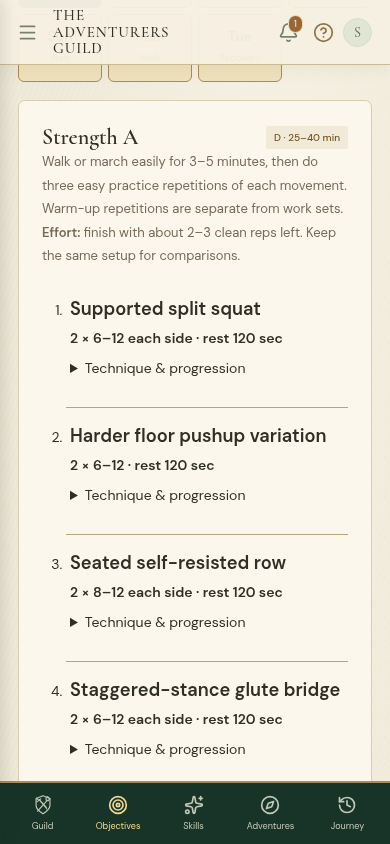
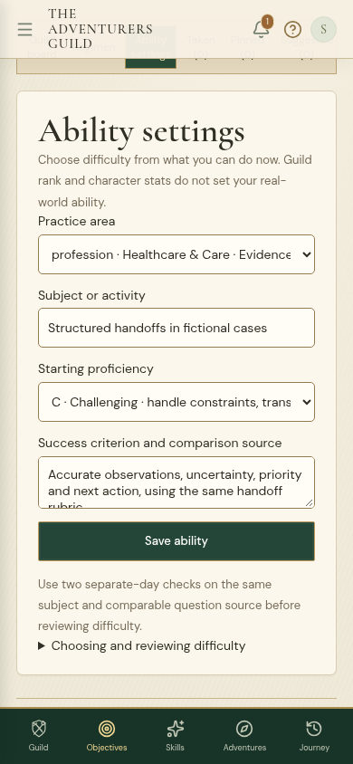
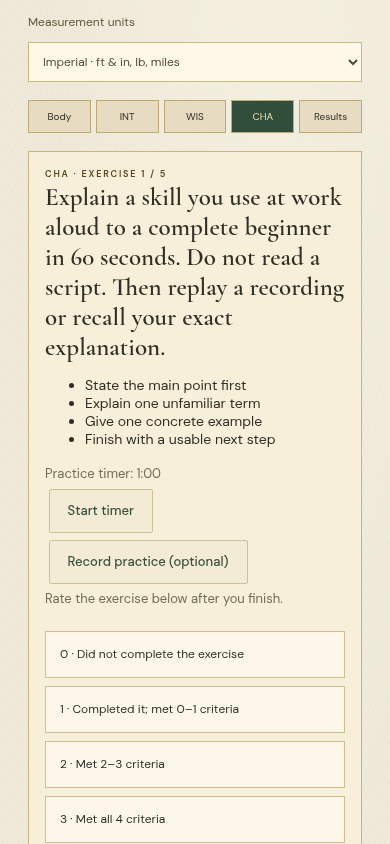

# Work matched to current ability — 1.26.0

A 35-floor-pushup result now suggests **C pushing practice with a harder variation**, and home full-body sessions use a harder pushing setup immediately. Session volume and exercise ability are separate: that result does not declare advanced ability in squats, pulling, core work or running.

[Research review and source-access limits](RESEARCH.md) · [Seven-stat fantasy proposal](STAT-PROPOSAL.md) · [Changes](../update-1.26.md) · [Verification](../verification-1.26.md) · [Android download](../../downloads/README.md)

## What to use

- **Objectives → Regimen → Edit plan:** select independent pushing and home leg/hip/core setups. Keep repetitions, range, setup, external load and clean reps left comparable. A new performance check can suggest reviewing a harder setup; taken sessions retain their original prescription.
- **Objectives → Ability settings** or **Settings → Ability:** choose a class focus, profession, vocation or universal activity; name a specific subject and success criterion/source; select F–C proficiency. The board opens the matching work variant. A chosen profession can also receive an initial subject/proficiency in registration.
- **Assessment:** imperial is the new-account default. Enter a timed mile in minutes and seconds and select walk or run/run-walk. Metric displays the same measured distance as 1.609 km. Older six-minute walk data remains supported and available as an alternative.
- **Mental checks:** INT uses logic and reasoning; WIS uses uncertainty, intuitive errors and judgment; CHA uses actual spoken exercises and a self-review rubric. Start reveals the work. Optional microphone use is user initiated and playback is temporary. The original six stat names remain.

## Coverage and software simulations

The [reproducible audit](../../scripts/audit-proficiency.mjs) checks **90 fictional 30-day ledgers / 2,700 account-days**. Every one of the twenty career categories and twenty-five vocations has a declared F and C subject profile. Each uses actual objective selection, manual acceptance, result submission, progression and save validation. Each declared routine completes one practice request daily, with a synthetic 8/10 checked outcome and 8 or 40 assigned minutes.

| Work track | Cases | Requests per account | Player XP after 30 days | Profession level | Vocation level |
| --- | --- | --- | --- | --- | --- |
| Profession, F | 20 | 30 | 300 | 3 | 1 |
| Profession, C | 20 | 30 | 4,500 | 4, pending exams | 1 |
| Vocation, F | 25 | 30 | 300 | 3 | 3 |
| Vocation, C | 25 | 30 | 4,500 | 4, pending exams | 15 |

Every selected variant matches its declared proficiency. All **2,700 duplicate submissions** are rejected and all **2,700 JSON save roundtrips** validate. Base stats stay unchanged: these particular routines include no exams or special weekly/monthly stat rewards. Vocation levels remain separate from exam-gated profession levels. No newly invented passes, credentials or class promotions are injected.

Six additional physical fixtures cover floor maxima **0, 4, 12, 20, 35 and 60**, recording both the board suggestion and actual home recipes. Unit checks cover all 96 combinations of F–C volume, A/B session, home/weights/gym, and pushing level; independent movement overrides; old recipe snapshots; and current class ownership for all 51 classes.

These are software ledgers with declared human inputs. They do not show that a novice becomes an expert in thirty days, validate the game's difficulty/reward multipliers, or replace the separate annual balance study. The six physical fixtures are not participants. [Raw outputs, source hashes and concrete assignments](ledger-results.json).

## Screens

| Mile assessment | Experienced strength setup | Career proficiency | Communication trial |
| --- | --- | --- | --- |
|  |  |  |  |

[Reasoning problem](screens/reasoning.png) · [Desktop proficiency](screens/career-proficiency-desktop.png) · [Six viewport scans](screens/scans.json).

## Limits and next work

The exact pushup cutoffs, rep-reserve choices, proficiency levels, 85%/60% review rules and new assessment anchors are authored choices informed by established principles. They have not been validated as norms or shown to cause real-world gains. Research access succeeded for OpenStax's publisher sources; primary-paper sites were proxy-blocked. The [review](RESEARCH.md) states which claims each source supports and which it does not.

The career assignments are maintained category guidance plus a subject/rubric chosen by the player. They are not complete profession-specific curricula or independently marked exams. A trustworthy subject-placement sampler and expert-reviewed rubrics remain priorities. Weekly/monthly calendars and prepared high-rank achievement standards are not revalidated in this daily-practice pass. More specialist assessments, comparable-form studies and human usage trials are still needed.

The Network Weaver scope collision is corrected for newly issued class requests, including after career changes; all existing receipt amounts and accepted contracts remain. Historical class-credit repair is still a separate migration task. Midnight recovery, companion-led builds, rewards and earned histories remain.
