# The Adventurers Guild 1.21.0 — screenshots

These are browser previews using sample characters. Exploration results, prior activity, and late-game unlocks are scripted fixtures for illustration. Open an image at full size.

## Supplies and economy — version 1.21

| Between-battle supplies | Quantity purchases | Delivery trade-offs |
| --- | --- | --- |
| [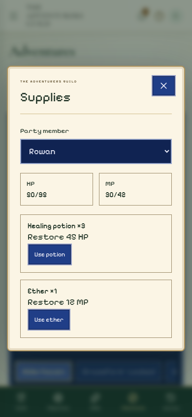](supply-satchel-mobile.png) | [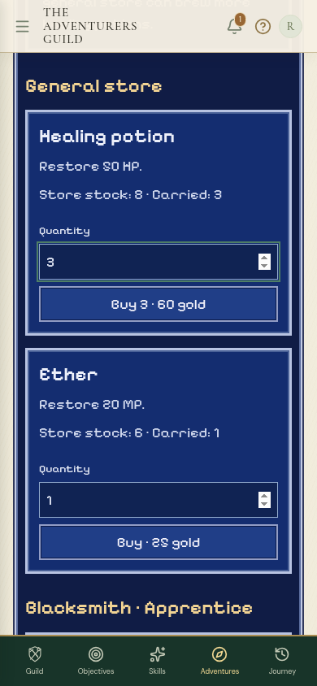](bulk-supplies-mobile.png) | [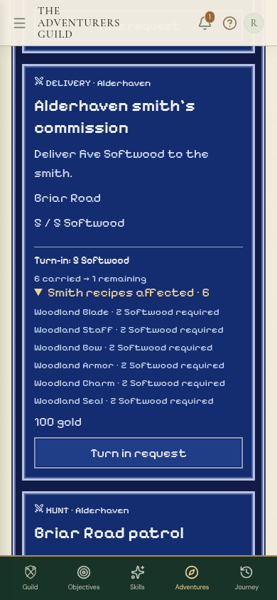](delivery-tradeoff-mobile.png) |

[Fallen target](fallen-supplies-mobile.png) · [CHA seal](cha-seal-mobile.png) · [Desktop supplies](supply-satchel-desktop.png) · [Desktop shop](bulk-supplies-desktop.png) · [Expedition supplies](expedition-supplies-mobile.png)

[Economy report and figures](../economy-1.21/README.md) · [Changes](../update-1.21.md) · [Verification](../verification-1.21.md) · [Capture fixtures and scans](../economy-1.21/screens/README.md). These use scripted sample reserves, stock and materials.

## Town and preparation tools — version 1.20

| Route folio | Crafting basket | Town services |
| --- | --- | --- |
| [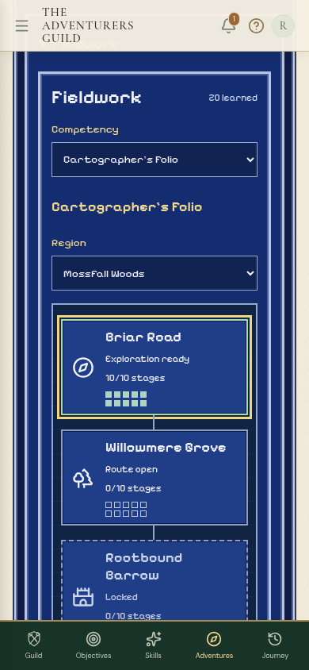](route-folio-mobile.png) | [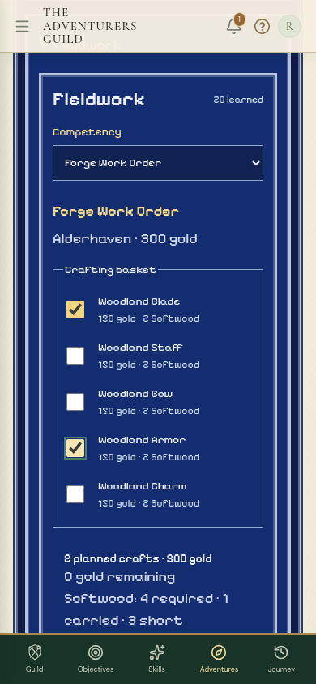](forge-order-mobile.png) | [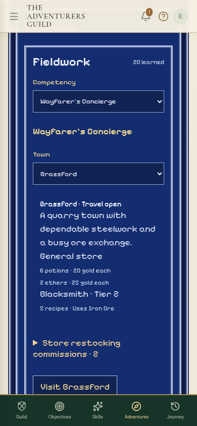](town-concierge-mobile.png) |

[Delivery offers](delivery-exchange-mobile.png) · [Commission receipts](receipt-register-mobile.png) · [Departure check](departure-check-mobile.png) · [Desktop folio](route-folio-desktop.png) · [Expedition concierge](expedition-concierge-mobile.png)

[Changes](../update-1.20.md) · [Verification](../verification-1.20.md) · [Capture fixtures and scans](../town-1.20/README.md). These are scripted sample skills, receipts, route progress and reserves.

## Service profession tools — version 1.19

| Route plan | Party recovery | Recruitment |
| --- | --- | --- |
| [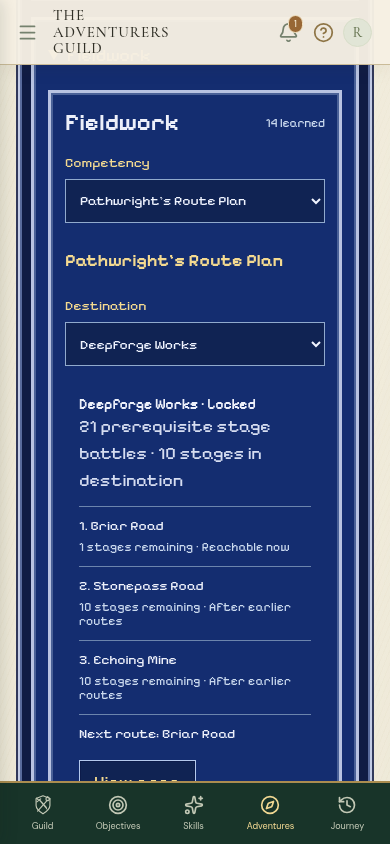](route-plan-mobile.png) | [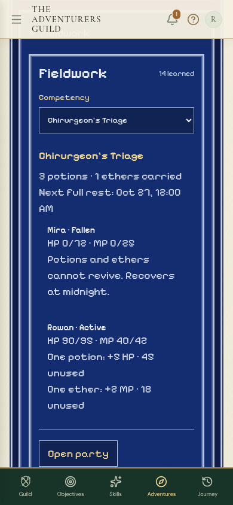](recovery-triage-mobile.png) | [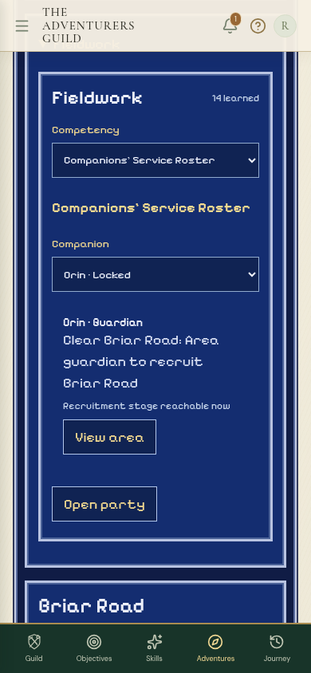](service-roster-mobile.png) |

[Field observations](field-record-mobile.png) · [Battle preparation](battle-primer-mobile.png) · [Commission terms](commission-writ-mobile.png) · [Desktop battle preparation](battle-primer-desktop.png) · [Expedition triage](expedition-triage-mobile.png)

[Changes](../update-1.19.md) · [Verification](../verification-1.19.md) · [Capture fixtures and scans](../service-1.19/README.md). These use scripted sample skills, reserves, stages and field records.

## Profession fieldwork — version 1.18

| Resource atlas | Equipment comparison | Spending plan |
| --- | --- | --- |
| [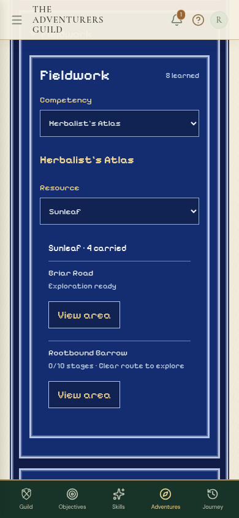](resource-atlas-mobile.png) | [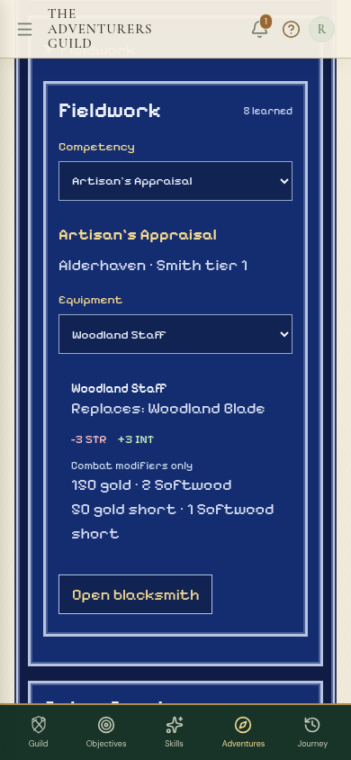](equipment-appraisal-mobile.png) | [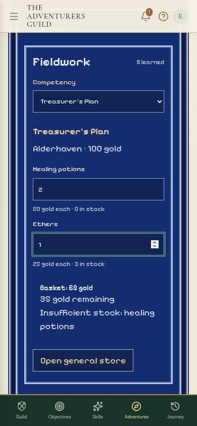](treasury-plan-mobile.png) |

[Guild docket](guild-docket-mobile.png) · [Delivery manifest](delivery-manifest-mobile.png) · [Danger watch](danger-watch-mobile.png) · [Eight-tool directory](field-tool-directory-desktop.png) · [Fieldwork during an expedition](expedition-fieldwork-mobile.png)

[Changes](../update-1.18.md) · [Verification](../verification-1.18.md) · [Capture fixtures and scans](../fieldwork-1.18/README.md). Learned skills, inventory and exploration progress in these previews are scripted sample records.

## Career work and save recovery — version 1.17

| Career work record | Learned fieldwork | Failed save |
| --- | --- | --- |
| [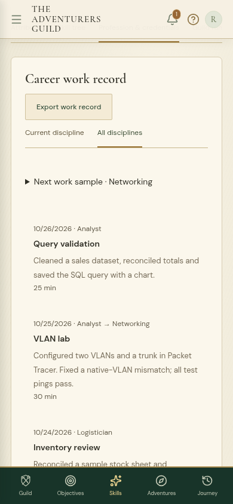](career-work-mobile.png) | [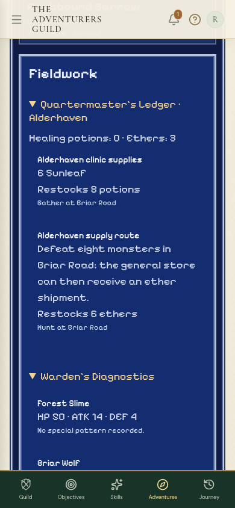](career-fieldwork-mobile.png) | [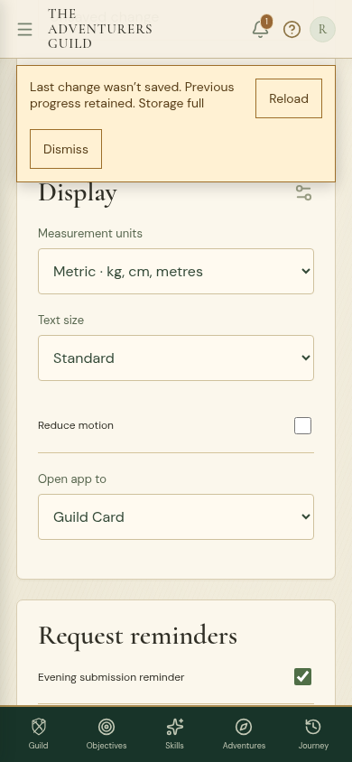](save-failure-mobile.png) |

[Desktop career record](career-work-desktop.png) · [Desktop fieldwork](career-fieldwork-desktop.png) · [Primary recovery options](primary-recovery-desktop.png)

[Changes](../update-1.17.md) · [Verification](../verification-1.17.md) · [Capture fixtures and storage probe](../career-1.17/README.md). Outcomes and learned utilities are scripted sample records. Google setup remains deferred.

## Saved plans and device recovery — version 1.16

| Planned skills | Restore comparison | Device recovery |
| --- | --- | --- |
| [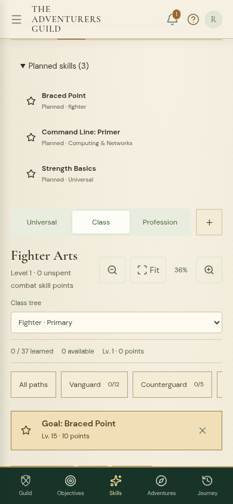](saved-plans-mobile.png) | [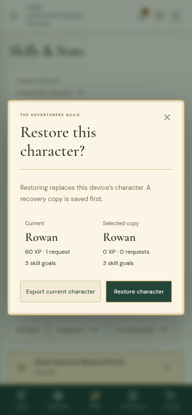](restore-comparison-mobile.png) | [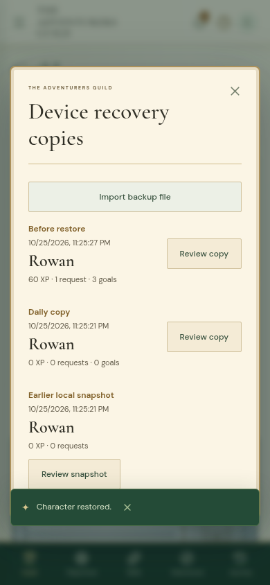](device-recovery-mobile.png) |

[Desktop plans](saved-plans-desktop.png) · [Goal reached](goal-reached-mobile.png) · [Restore from registration](registration-restore-mobile.png) · [Damaged-save recovery options](recovery-options-desktop.png)

[Changes](../update-1.16.md) · [Verification](../verification-1.16.md) · [Capture method and scan results](../planning-1.16/README.md). Goals and completed requests in these images are scripted sample records. Google setup remains deferred.

## Current work, results and reserves — version 1.15

| Current work | Parchment actions | Optional results |
| --- | --- | --- |
| [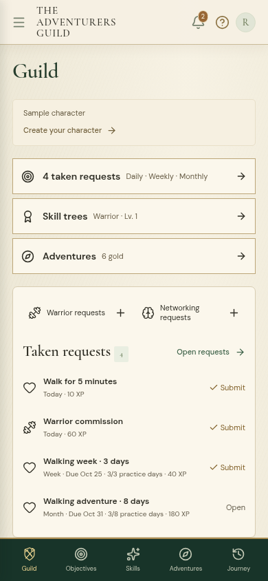](daily-hub-mobile.png) | [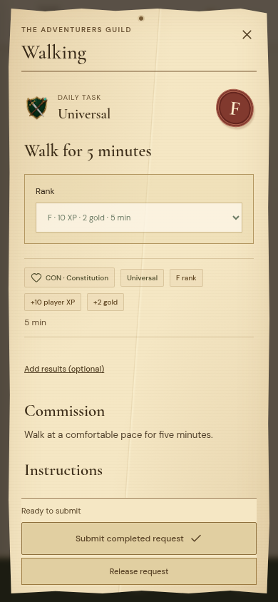](request-actions-mobile.png) | [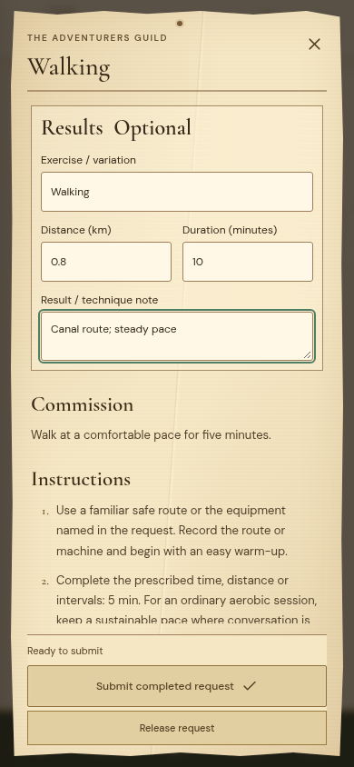](request-results-mobile.png) |

[Practice charts on desktop](practice-results-desktop.png) · [Practice charts on phone](practice-results-mobile.png) · [Party reserves](party-reserves-mobile.png) · [Exhausted party](party-exhausted-mobile.png)

[Changes](../update-1.15.md) · [Reserve probes](../combat-1.15/README.md) · [Verification](../verification-1.15.md). Earlier sections show previous releases; current HP/MP recover at midnight rather than between encounters.

## Ranked techniques and enemy tactics — version 1.14

| Skill refinement | Enemy shell | Guardian wind-up |
| --- | --- | --- |
| [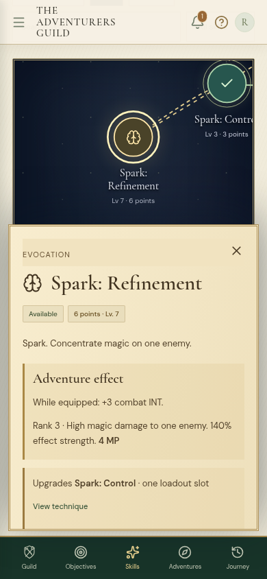](ranked-spark-refinement-mobile.png) | [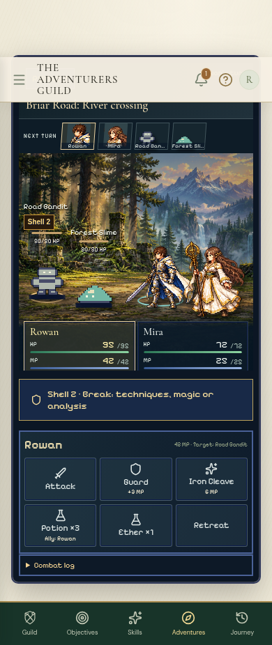](briar-shell-mobile.png) | [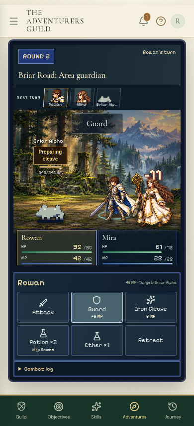](guardian-windup-mobile.png) |

[Control rank](ranked-spark-control.png) · [Upgraded loadout](upgraded-loadout-mobile.png) · [Ranked skill in battle](ranked-skill-battle-mobile.png) · [Guardian cleave](guardian-cleave.png)

[Changes](../update-1.14.md) · [Combat probe report](../combat-1.14/README.md) · [Verification](../verification-1.14.md)

## Stat boards and skill constellations — version 1.13

| Universal boards | Selected skill | Full constellation |
| --- | --- | --- |
| [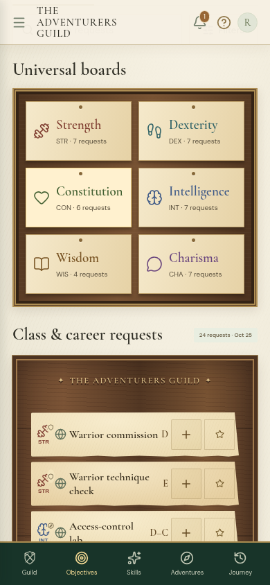](universal-boards-mobile.png) | [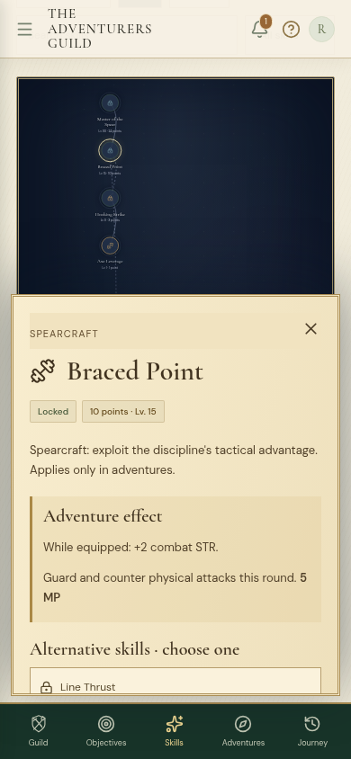](skill-inspector-mobile.png) | [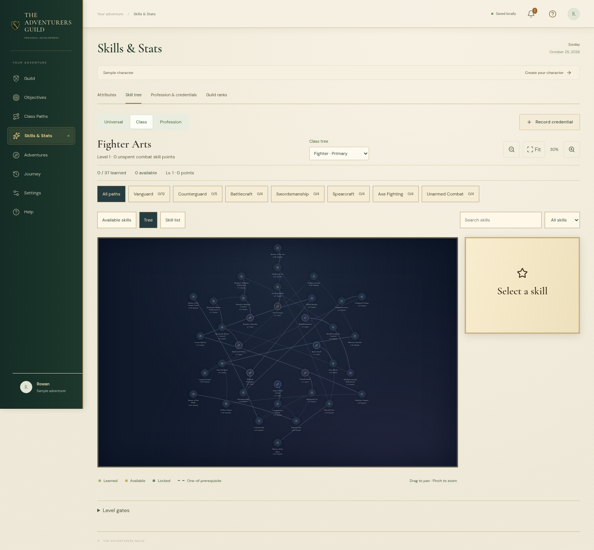](constellation-desktop.png) |

[Wisdom requests](wisdom-board-mobile.png) · [Phone constellation overview](constellation-mobile.png) · [Desktop skill panel](skill-inspector-desktop.png) · [Universal constellation](universal-constellation.png) · [Career constellation](career-constellation.png)

[Changes](../update-1.13.md) · [Verification](../verification-1.13.md)

## Parchment requests and ten-stage routes — version 1.12

| Request details | Attribute icons | Current stage |
| --- | --- | --- |
| [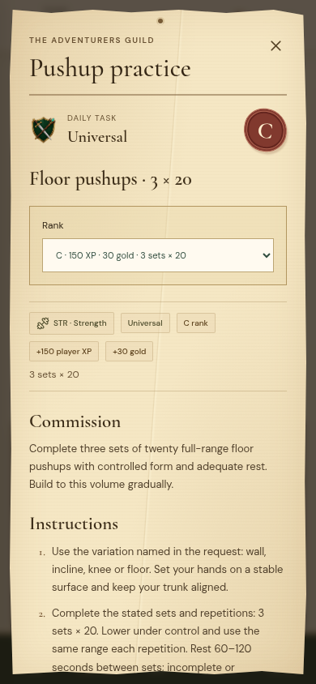](parchment-request-mobile.png) | [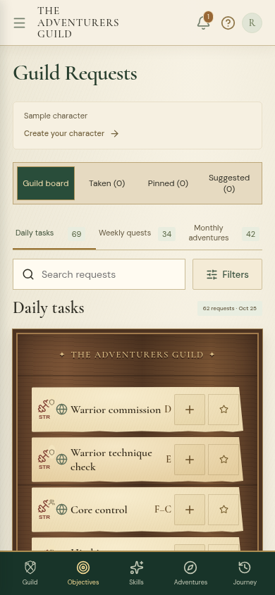](request-stat-icons-mobile.png) | [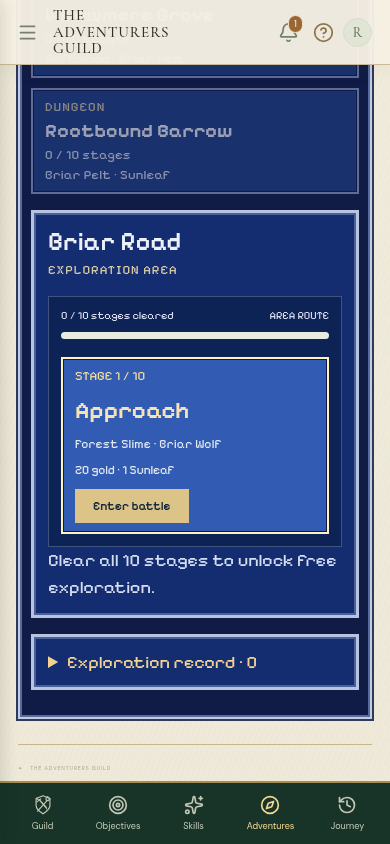](current-stage-mobile.png) |

[Full instructions and completion](parchment-request-instructions-mobile.png) · [Desktop parchment](parchment-request-desktop.png) · [Desktop board](request-stat-icons-desktop.png) · [Desktop area](current-stage-desktop.png) · [Tenth-stage guardian](current-stage-guardian.png) · [Guild navigation](guild-emblem-mobile.png) · [Full emblem](../../public/art/guild-crest.png)

[Changes](../update-1.12.md) · [Verification](../verification-1.12.md)

## Daily use and progression — version 1.11

| Guild actions | Request board | Readable tree |
| --- | --- | --- |
| [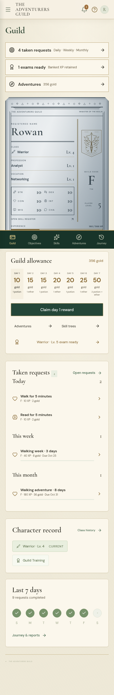](guild-actions-mobile.png) | [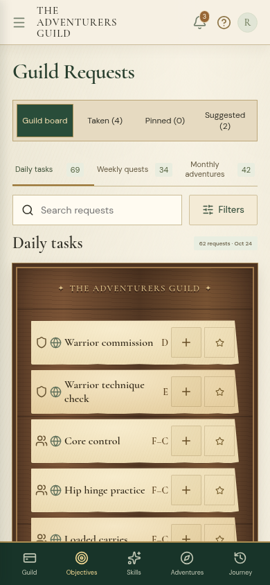](requests-streamlined-mobile.png) | [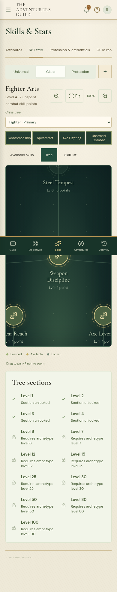](readable-tree-mobile.png) |

[All taken requests](requests-all-taken-mobile.png) · [Real-world performance](raw-performance.png) · [Full reports](performance-reports-mobile.png) · [Next class milestone](class-next-step-mobile.png) · [Earned mastery exam](mastery-exam-mobile.png)

[Changes](../update-1.11.md) · [Verification](../verification-1.11.md)

## Pixel art and portraits — version 1.10

[Full sprite roster](pixel-roster.png) · [Close-up portraits](portrait-roster.png) · [Portraits on phone](portrait-roster-mobile.png) · [Seven companions](companions-pixel.png) · [Battle](pixel-battle.png) · [Three-member phone battle](pixel-battle-mobile.png)

| Portrait choices | Three-member battle |
|---|---|
| [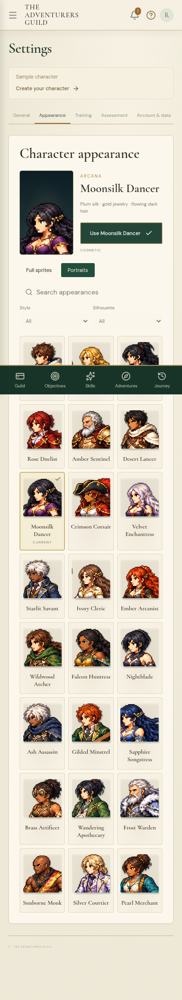](portrait-roster-mobile.png) | [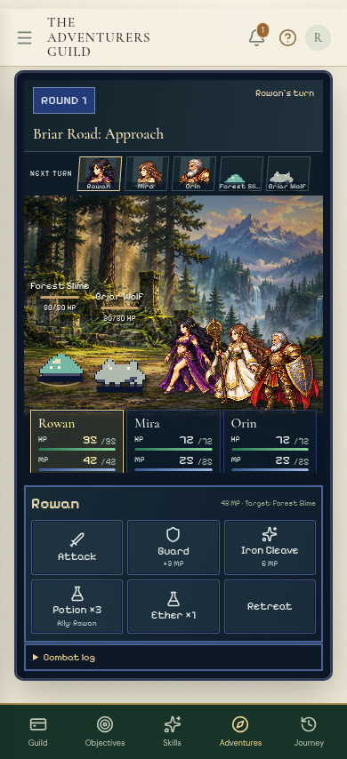](pixel-battle-mobile.png) |

[Refinements](../update-1.10.md) · [Verification](../verification-1.10.md)

## Character roster — version 1.9

[Full roster](appearance-roster.png) · [Phone appearance picker](appearance-roster-mobile.png) · [Updated battle](character-battle.png) · [Battle on phone](character-battle-mobile.png)

| Character picker | In battle |
|---|---|
| [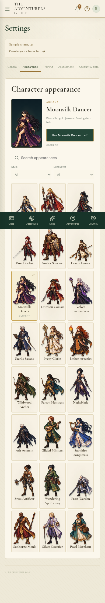](appearance-roster-mobile.png) | [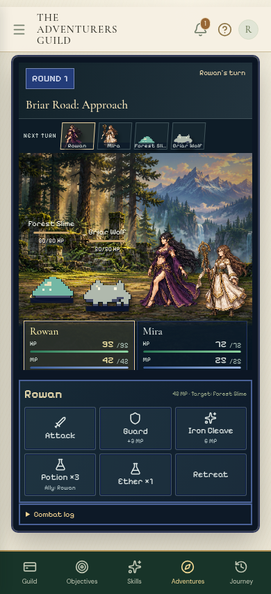](character-battle-mobile.png) |

[Character appearance rules](../update-1.9.md) · [Verification](../verification-1.9.md)

## Guild hub — version 1.8

| Guild hub | Compact board | Battle |
|---|---|---|
| [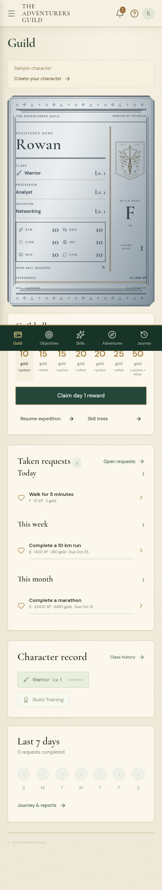](guild-hub-mobile.png) | [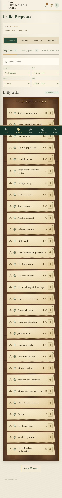](compact-objectives-mobile.png) | [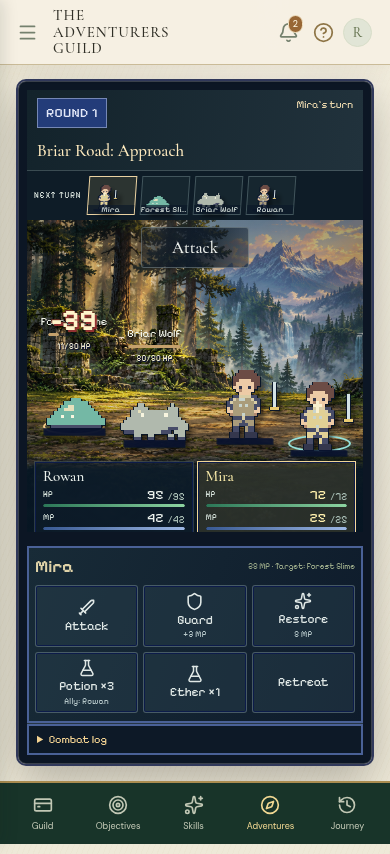](battle-polished-mobile.png) |

[Desktop hub](guild-hub.png) · [Desktop board](compact-objectives.png) · [Desktop battle](battle-polished.png) · [Attack feedback](battle-impact.png) · [Continuing exploration](expedition-mobile.png) · [Tree overview](skill-tree-overview-mobile.png) · [Searchable skills](skill-list-mobile.png) · [Reminder settings](reminders-settings.png)

[Version 1.8 rules and rewards](../update-1.8.md) · [Verification](../verification-1.8.md)

## Earlier world and content previews

| Grouped objectives                                                                                                          | Rank selection                                                                                                                      | Pixel party battle                                                                                                                           |
| --------------------------------------------------------------------------------------------------------------------------- | ----------------------------------------------------------------------------------------------------------------------------------- | -------------------------------------------------------------------------------------------------------------------------------------------- |
| [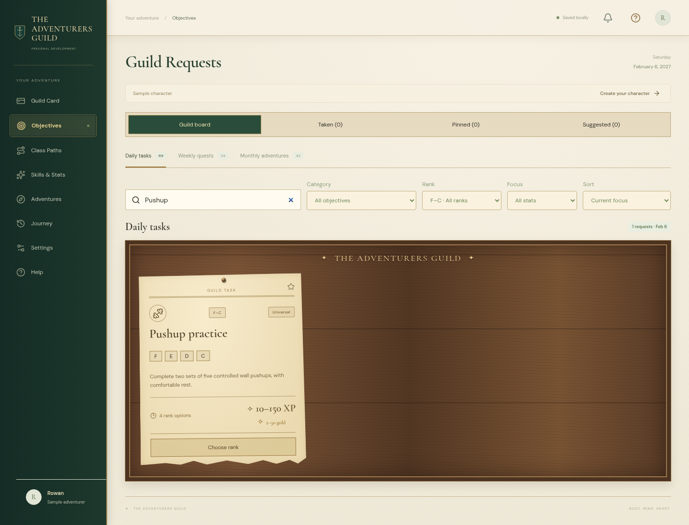](objective-groups.png) | [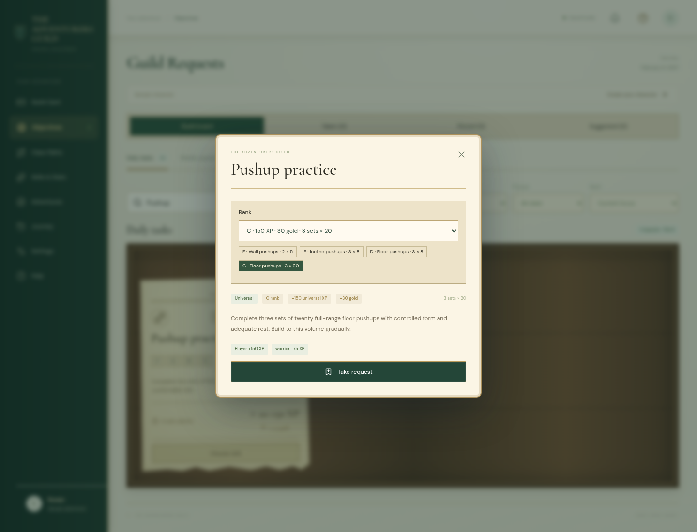](request-rank-picker.png) | [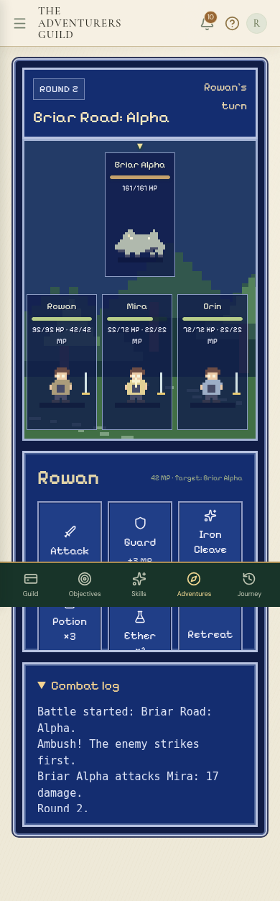](pixel-battle-android.png) |

[Expanded board](objectives-expanded.png) · [Weekly retrospective progress](weekly-retroactive.png) · [Required hybrid quest](hybrid-required.png) · [Required quest after delivery](hybrid-ready.png) · [Optional adventure bonus](hybrid-bonus.png)

[World map](world-desktop.png) · [Free exploration](world-exploration.png) · [Boss discovery](boss-warning.png) · [Ambush battle](ambush-battle.png) · [Adventure guild commissions](world-guild-requests.png)

[Town potion shortage](town-shortage.png) · [Store after a medicinal-herb delivery](town-restocked.png) · [Frostholm grandmaster smith](town-grandmaster.png) · [Seven companions](companions-expanded.png)

## Retained feature previews

These show the existing guild, class, assessment, Settings, and Journey features. Older interface screenshots reflect the release in which they were captured; the 1.18 previews above show the current update.

[Guild Card on phone](guild-android.png) · [Guild Card detail](guild-card-detail.png) · [Rank metals](rank-metals.png) · [Class register](class-paths.png) · [Class comparison](class-comparison.png) · [Full Fighter skill web](fighter-web.png) · [Career tree](profession-tree.png) · [Vocation](vocation.png)

[Settings](settings.png) · [Gym preferences](training-preferences.png) · [Metric assessment](assessment.png) · [Feet and inches](assessment-imperial.png) · [Mental check before Start](mental-ready.png) · [Question in progress](mental-check.png) · [Examinations](examinations.png)

[Journey reports](journey-reports.png) · [Journey chronicle](journey-timeline.png) · [Journey on phone](journey-android.png) · [Help](help.png) · [Registration](welcome.png)

[Version 1.7 rules and content](../update-1.7.md) · [Verification](../verification-1.7.md)

Browser viewport checks do not establish runtime verification on a physical Android device.
