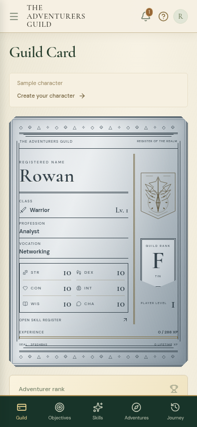
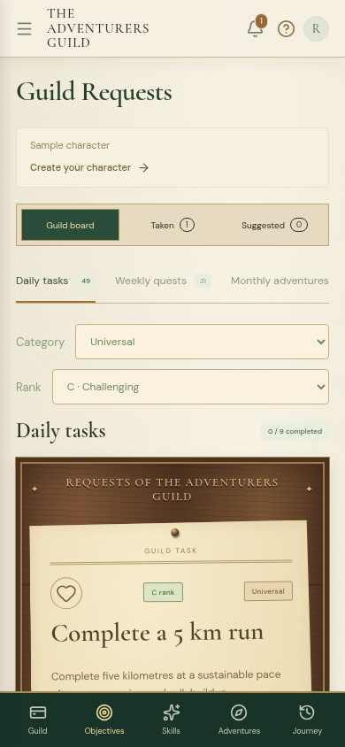
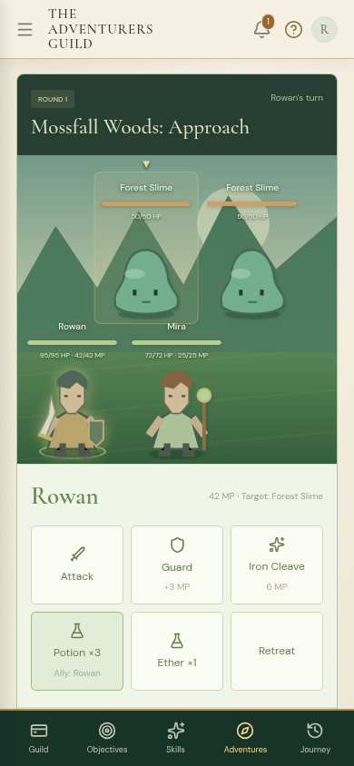

# The Adventurers Guild 1.6.0 — screenshots

All previews use the sample character. Journey previews include illustrative sample activity. Open an image to view it at full size.

[Rank metal cards](rank-metals.png) · [Full Fighter skill web](fighter-web.png) · [Improvement examinations](examinations.png) · [Physical exam](milestone-exam.png) · [Passed milestone](milestone-passed.png)

[Gym preferences](training-preferences.png) · [Feet and inches assessment](assessment-imperial.png) · [Mental check before Start](mental-ready.png) · [Question in progress](mental-check.png) · [Notifications](notifications.png) · [Adventure Guild requests placeholder](adventure-guild-requests.png)

| Guild Card                                                                                              | Request board                                                                                                          | Party battle                                                                                                        |
| ------------------------------------------------------------------------------------------------------- | ---------------------------------------------------------------------------------------------------------------------- | ------------------------------------------------------------------------------------------------------------------- |
|  |  |  |

[Settings](settings.png) · [Settings on Android](settings-android.png) · [Large text on Android](settings-large-android.png) · [Assessment](assessment.png) · [Assessment results](assessment-results.png) · [Ranked requests](ranked-requests.png)

[Journey reports](journey-reports.png) · [Journey chronicle](journey-timeline.png) · [Journey on Android](journey-android.png) · [Taken requests](taken-requests.png) · [Help](help.png)

[Guild Card detail](guild-card-detail.png) · [Class register](class-paths.png) · [Class comparison](class-comparison.png) · [Vocation](vocation.png) · [Shared Fighter tree](skill-tree.png) · [Career tree](profession-tree.png) · [Desktop Guild Card](guild-desktop.png) · [Registration](welcome.png)

These are browser previews at desktop and Android phone viewport sizes. They do not establish physical-device runtime verification.

[Monthly adventure board](monthly-adventures.png) · [Saved preparation across months](monthly-progress.png) · [Balance report and graphs](../balance-report-1.6.md).
