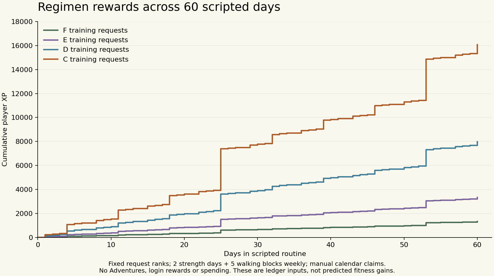

# Task efficacy and balanced training — 1.25.0

The main weakness was a catalogue of isolated activities rather than a repeatable training programme. A person could complete more pushups without seeing what to train next, omit pulling/hinge work, or earn study rewards without checking what they learned. Version 1.25 adds a two-day balanced strength regimen, separate walking progression and comparable results. It does not claim that a game rank or elapsed time guarantees a physiological outcome.

## Evaluation of the current task families

| Area | Finding | Change / remaining limit |
| --- | --- | --- |
| Strength | Pushup/squat counts gave a clear completion target but did not form a balanced plan. High repetitions measure muscular endurance more than maximal strength. | A/B sessions cover legs, push, row, hinge and trunk; exact sets, range, rest, technique and progression are supplied. Existing high-volume achievements are explicitly optional endurance assessments. |
| Aerobic fitness | Short walks are a useful entry point. A short walk should not be presented as the complete adult activity target. The run/walk estimate omitted part of its warm-up/cool-down. | Walk target is independent of strength rank. Build from 5 minutes toward five 30-minute brisk blocks. The interval request is now explicitly 28 minutes; the brisk request has 30 brisk minutes plus easy warm-up/cool-down. Running targets require preparation rather than daily maximal effort. |
| Movement, balance, recovery | Time alone is a weak measure of movement quality; vague circuits are hard to reproduce. | Wall-push, squat, balance, mobility, core, hinge and carry requests now specify exercises/reps/holds/rest. Use the same support, range and setup. Broader sport-specific coordination benchmarks remain future content. |
| Learning and professions | Minutes cannot compare CCNA study with an unrelated subject, and passive rereading is a weak outcome measure. | Existing retrieval/application class instructions are retained. Results can now save subject/source, checked questions attempted and correct answers, including zero. Journey groups accuracy by topic. Equated question difficulty and verified vocational assessments are not implemented. |
| Wisdom/faith | Reading volume is not equivalent to comprehension, judgment or spiritual maturity. | Keep passage context, summaries, checking and application in Christian practice. The app does not validate spiritual worth or turn Scripture into a mental-assessment question bank. No Bible questions were added to assessments. |
| Communication | Social contact counts do not establish communication ability. | Existing individual recording/revision practice and group quests serve different purposes. Improvement needs a specific rubric or feedback; validated communication scoring remains open. |
| Rewards | A full routine could be abused if every component automatically paid again; generic class frequency assumed more strength days than this plan. | Full sessions pay once at their ordinary F–C rate. Strength-focused classes use the chosen dose and two/eight-day weekly/monthly goals. Hybrid classes retain a required secondary-focus checklist. Overlapping hard-strength requests block another full session for 48 hours. This is self-report, not comprehensive exercise verification. |
| Higher ranks | Larger numbers and longer durations do not, by themselves, establish expertise. | Daily requests remain F–C, weekly at most A, monthly at most SSS. The rank guide distinguishes ordinary training from prepared/assessed achievements. Existing B–SSS specialist standards need further discipline-specific expert review; this release does not make them validated population percentiles. |

## The default week

Choose **Guild → Today's regimen** or **Objectives → Regimen**. The first strength day anchors a repeating seven-day cycle, rather than requiring a Monday start. Every request still needs a deliberate Take and Submit.

| Day in cycle | Work |
| --- | --- |
| 1 | Strength A and chosen walking block |
| 2 | Walking block |
| 3 | Walking block |
| 4 | Strength B |
| 5 | Walking block |
| 6 | Walking block |
| 7 | Recovery; comfortable movement as desired |

Walking starts at **5 minutes**, separately adjustable in five-minute steps to 30. The F plan deliberately falls below the long-term aerobic target while establishing consistency. Where appropriate, build toward **150 moderate minutes per week**; a brisk block uses the talk test (conversation possible, singing difficult). Easy walking minutes are not automatically counted as moderate exercise.

### Strength dose ladder

| Request rank | Work sets per movement | Reps per set | Rest | Target clean reps left | Approximate session | XP / gold |
| --- | --- | --- | --- | --- | --- | --- |
| F — introduction | 1 | 5–8 | 90 sec | 3–4 | 10–15 min | 10 / 2 |
| E — foundation | 2 | 6–10 | 90 sec | 2–4 | 20–30 min | 25 / 5 |
| D — regular training | 2 | 8–12 | 120 sec | 2–3 | 25–40 min | 60 / 12 |
| C — challenging training | 3 | 6–10 | 120 sec | 2–3 | 35–50 min | 150 / 30 |

These are authored game doses, not population norms. A C session must also use a suitably challenging controlled variation/load; doing more easy sets is not proof of advanced strength. The F–C ladder has **24 exact recipes**: four ranks × two sessions × three equipment modes. Warm up for 3–5 minutes and perform three easy practice repetitions of each movement before the work sets. Time estimates vary with setup and rest.

“Doing your best” means completing repeatable, controlled work at the prescribed effort and recovering, rather than reaching failure each day. The app suggests E only from a recorded floor-pushup or controlled bench assessment; otherwise it defaults to F. Those are conservative game cutoffs, not reliable full-body placement or proof that an old result still describes current fitness. Choose F after a long break and select each movement's difficulty independently.

### Specific movements

| Pattern | Home, no weights | Weights / weighed sturdy backpack | Gym |
| --- | --- | --- | --- |
| Legs A | Chair sit-to-stand at F; bodyweight squat above F | Goblet squat | Leg press |
| Legs B | Chair sit-to-stand at F; supported split squat above F | Supported split squat holding a dumbbell | Leg press |
| Push | Wall/incline/floor pushup selected for control and effort | Dumbbell floor press | Machine chest press |
| Pull | Self-resisted row | Supported one-arm row | Seated cable row |
| Hinge | Glute bridge | Dumbbell Romanian deadlift | Dumbbell Romanian deadlift |
| Trunk | Dead bug A / bird dog B | Same | Same |

Per-side exercises use the prescribed reps **on each side**. Record the lower completed count if unequal; graphs conservatively count that on both sides. The screen includes setup/range cues and progression for each movement. Record total external load moved per repetition: one dumbbell for a one-arm row; combined load when both dumbbells move together. Machine-stack numbers are comparable only on the same machine/setup.

The home row is a practical starting movement, but self-applied resistance is difficult to standardize. It is **not equivalent to a measured loaded-row test**. Measurable pulling progression needs a consistent external load or suitable equipment. A beginner unfamiliar with loaded hinges should learn the movement at an easy load rather than treating a reward as a reason to force it. Stop a movement that causes pain or loss of control and choose an appropriate alternative.

## How progression works

1. Log actual work sets, setup/variation, load where required, and clean reps left. Rep inputs start blank. A previous setup/load can be reused; previous performed reps cannot silently become today's result.
2. First increase repetitions within the same range. After **two comparable top-range sessions on separate dates** with at least two clean reps left, suggest a harder variation or a small **2–5%** load increase, when practical. Change one variable at a time.
3. Compare the same rank, environment, exercise, variation and load. Changing load does not masquerade as an apples-to-apples repetition gain. Imperial values are stored as kilograms with a small rounding tolerance.
4. Four logged training days spanning at least ten days, both A/B sessions and two strong recent sessions trigger a **manual rank-review prompt**. This is a readiness prompt, not an examination or automatic promotion.
5. Early checks emphasize attendance, technique and repeatability. Later checks compare controlled reps/load and a real reassessment. The app does not promise a fixed percentage improvement after a week or month.

A new rank may start near the lower end of a new rep range. The C range is lower than D because it is intended for a harder load/variation, not a regression in capability. Users choose that load; the app does not automatically prescribe kilograms from game STR. There is no claim that game stats map one-to-one to physical capacity.

Completed sets feed Journey trends and the next-session comparison. Unfinished sets remain a **device-local draft**, not an earned receipt or independent Journey activity. A successful saved submission clears the draft; a failed primary save retains it for retry. Character backups include accepted/completed prescriptions and results, but do not export unfinished device drafts. Independent failed-session logging, editing/imports, richer periodization and substitutions remain P04/P09 follow-ups.

## Class credit, calendar goals and game stats

The same complete workout can be taken as a universal request or the matching strength-primary class commission. The latter pays that class directly and preserves its secondary real-world focus: for example, a Paladin must also complete its Bible practice. The physical form remains editable until that checklist is finished. Other class identities retain their existing practice instructions.

Regimen goals require **two recorded full-body days per calendar week** or **eight per calendar month**, at least the selected rank, plus a review/next-target checklist. They can count legitimate already-recorded work within the current window, but require manual acceptance and submission. They expire at the existing calendar boundary; they do not renew or carry into the next window. Strength-class calendar goals adapt to the same two-day schedule. Technique-only class practice cannot substitute for a recorded full-body session in these goals. Easy technique checks use a separate practice group and do not impose a hard-workout recovery delay. Existing accepted contracts retain their original rank/equipment/requirements when the plan is edited.

A complete session pays the existing rank reward once. It does not automatically award pushup, row, leg and core requests as extra daily payouts. Existing explicitly accepted weekly/monthly goals may award their own commitment reward. The 48-hour overlap guard prevents another full hard-strength session after logged pushing/pulling/leg/full-body work. It is not a complete anti-cheat model for every possible core/accessory combination.

Base stats still increase only through existing class/profession milestone exams or explicit special rewards. Completing workout logs does **not** directly inflate stats, and this release changes no rank threshold, level curve, prior receipts, Adventure reserves or existing gold source. Measured work is evidence of improvement; RPG numbers remain motivational abstractions.

## Sixty-day ledger verification

Run `npm run simulate:regimen`. [Raw results and source hashes](ledger-results.json) cover **24 scripted accounts / 1,440 account-days**: F/E/D/C × home/weights/gym × class/universal credit. Every case uses a Warrior with the Analyst profession, starts on 1 February 2027, spans the DST boundary in America/Denver and includes 7-/30-/60-day checkpoints.

Inputs explicitly assume the work was done: top-range reps, three reps left and 10 kg for loaded movements. These are **ledger simulations, not predictions of human fitness gains or realistic absolute loads for every exercise**. Each account keeps its chosen rank, completes 18 workouts, 43 walking blocks, nine weekly goals and two monthly goals. Walking targets are 5/15/30/30 minutes for F/E/D/C. Only the new regimen calendar goals are accepted; existing class-calendar reviews and other universal commitments are not claimed. No login rewards, Adventures, spending, unrelated work or fabricated exam passes are included.

| Fixed training rank | Day 7 XP / gold | Day 30 XP / gold | Day 60 XP / gold | Day 60 Guild rank / player level |
| --- | --- | --- | --- | --- |
| F | 110 / 22 | 650 / 130 | 1,330 / 266 | F / 4 |
| E | 275 / 55 | 1,625 / 325 | 3,325 / 665 | E / 7 |
| D | 660 / 132 | 3,900 / 780 | 7,980 / 1,596 | E / 12 |
| C | 1,200 / 240 | 7,770 / 1,554 | 16,080 / 3,216 | D / 18 |

[Checkpoint CSV](checkpoints.csv) · [Standalone figure](scripted-xp.svg). Reproduce the figure with `python3 scripts/plot-regimen.py` after the ledger run.

All 432 repeated-payout attempts and 432 alternate-session recovery bypasses are rejected. Gold reconciles to receipts and characters validate after every day; base stats remain unchanged without exams. The same inputs give matching player-XP/gold totals across equipment and class/universal routes. Class progression and universal transferable experience still follow their different existing rules. A high-dose C fixture does not reach A Guild rank in two months. This limited routine does not replace the earlier all-source economy or 9–12-month Gold-rank calibration.

## Evidence and limits

The guidance is based on established principles: start from current ability, repeat strength work at least twice weekly, include major movement patterns, progress resistance/repetitions with recovery, and combine learning with retrieval and checked application.

- [CDC adult physical activity guidance](https://www.cdc.gov/physical-activity-basics/guidelines/adults.html): adult aerobic/strength targets and useful shorter bouts.
- [WHO physical activity and sedentary behaviour guidelines, 2020](https://www.who.int/publications/i/item/9789240015128): 150–300 moderate aerobic minutes and major-muscle strengthening at least twice weekly.
- [ACSM progression models, 2009; PMID 19204579](https://pubmed.ncbi.nlm.nih.gov/19204579/): progressive resistance and repetition/load adjustment. The app's 2–5% suggestion is conservative within the paper's described 2–10% adjustment range; it is not a quotation prescribing this exact app programme.
- [NHS home strength exercises](https://www.nhs.uk/live-well/exercise/strength-exercises/): accessible supported movements.
- [Dunlosky et al., 2013](https://doi.org/10.1177/1529100612453266): practice testing and distributed practice; subject and question difficulty still matter.

**Source-access limit:** public CDC/NHS/WHO/PubMed requests returned proxy HTTP 403 in this environment. These are established references, not freshly retrieved or verified 2026 editions. The exact F–C recipes, game cutoffs, RIR ranges, review rules and rewards are authored implementation choices. No clinical efficacy trial, direct human progress data, qualified coaching review or validated knowledge/character scoring is claimed.

Next efficacy work should prioritize a small adherence/usability pilot; exercise substitutions and independent partial logs; verified discipline-specific B–SSS performance standards; and topic-specific parallel knowledge checks. Review measurable results and recovery before increasing volume. [Working backlog](../../ROADMAP.md) · [Release changes](../update-1.25.md) · [Verification](../verification-1.25.md) · [Previews](../screenshots/README.md).
